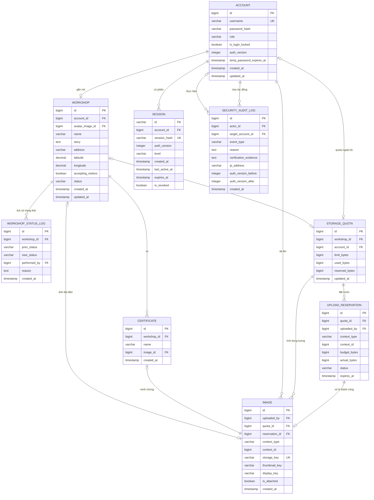
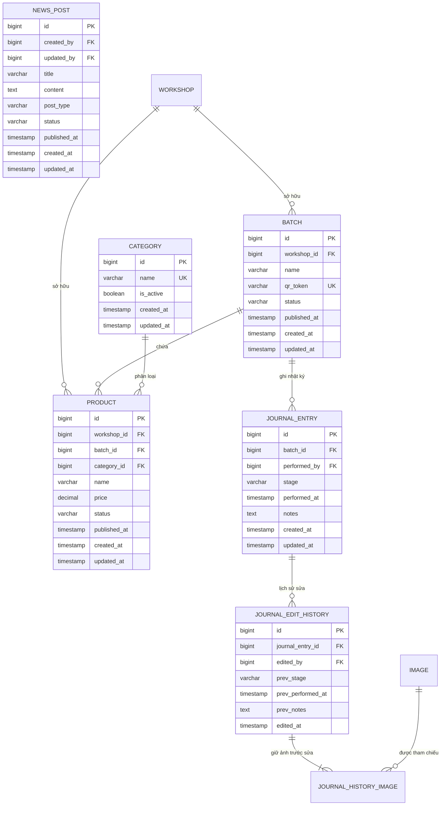
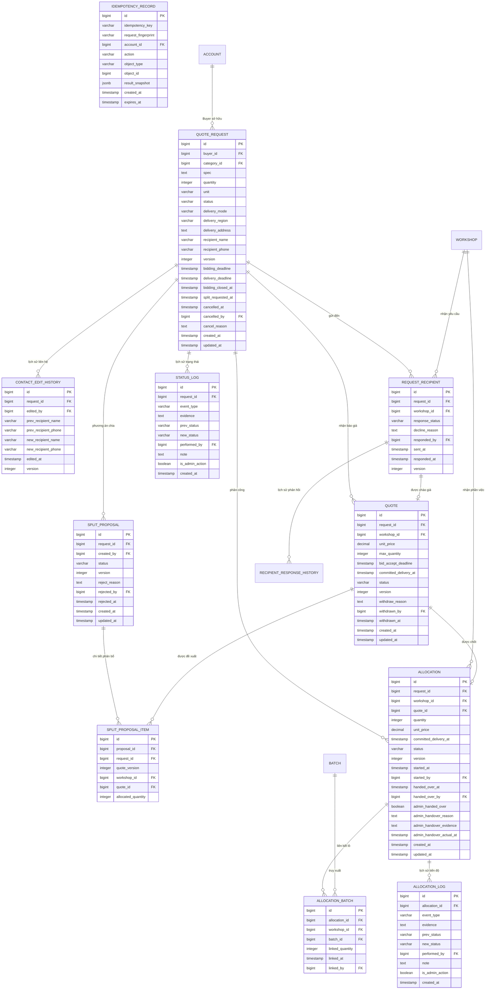
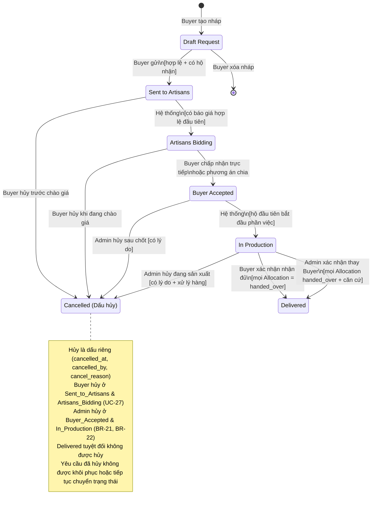
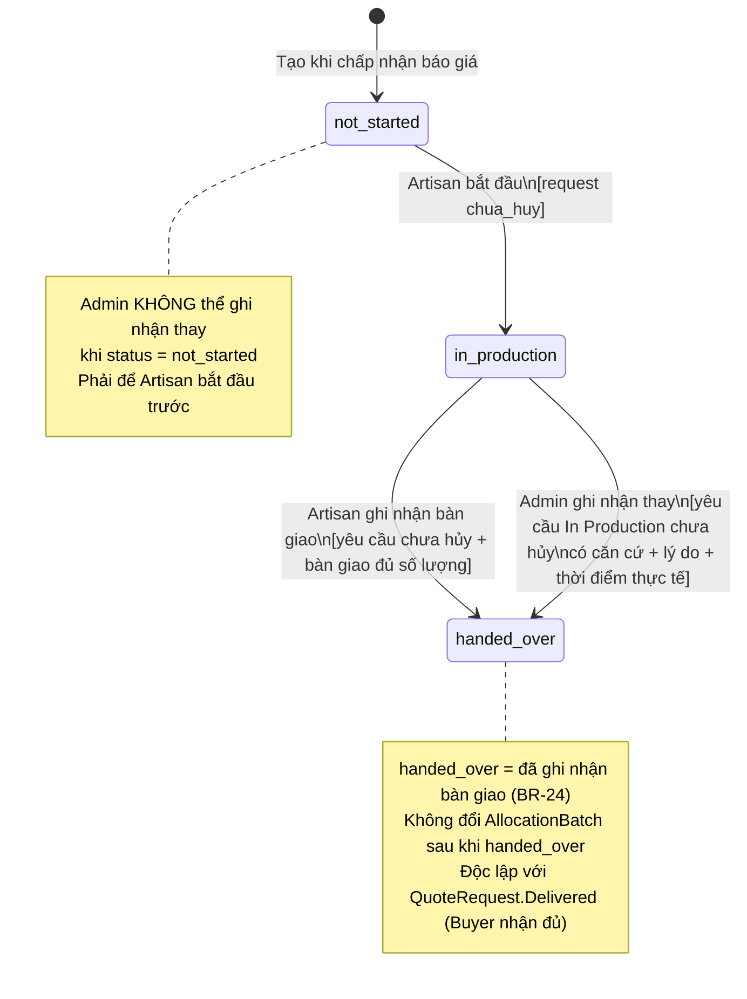
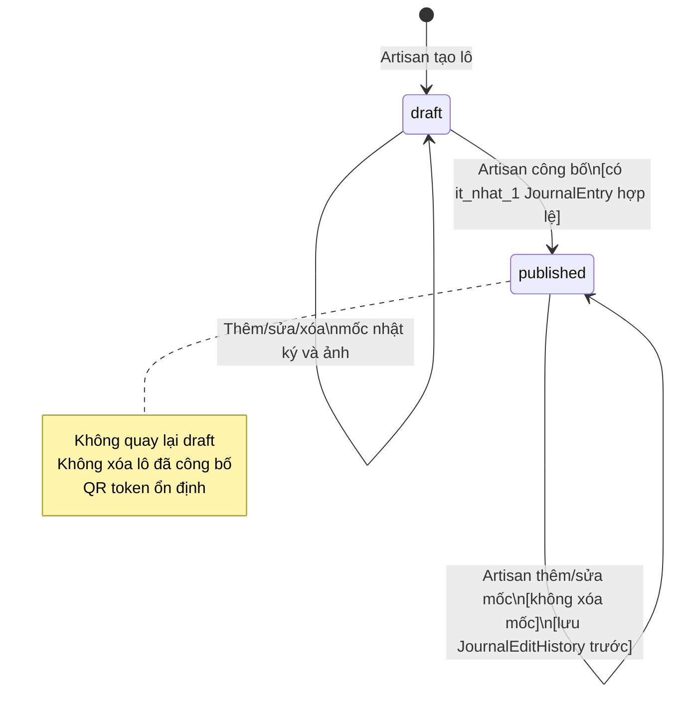
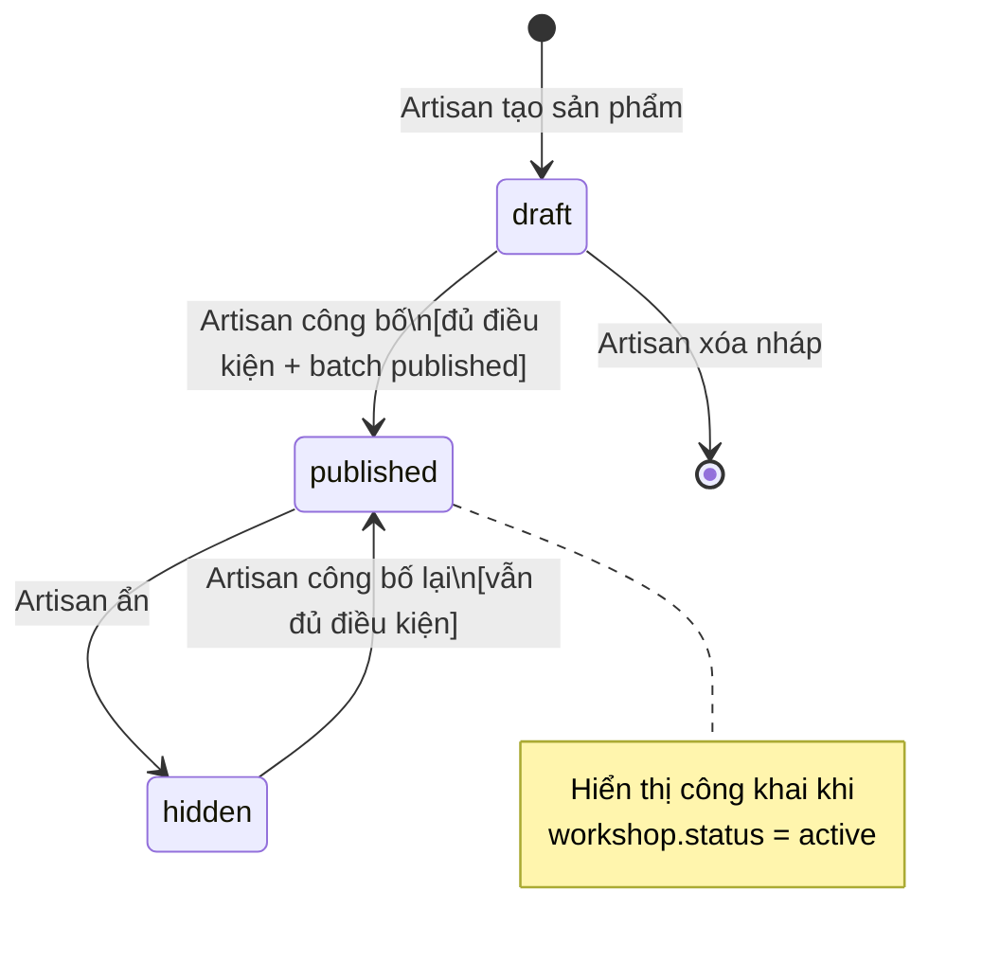
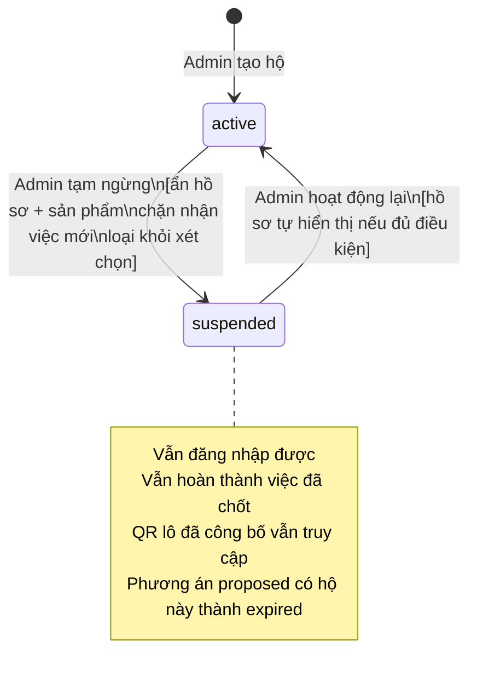
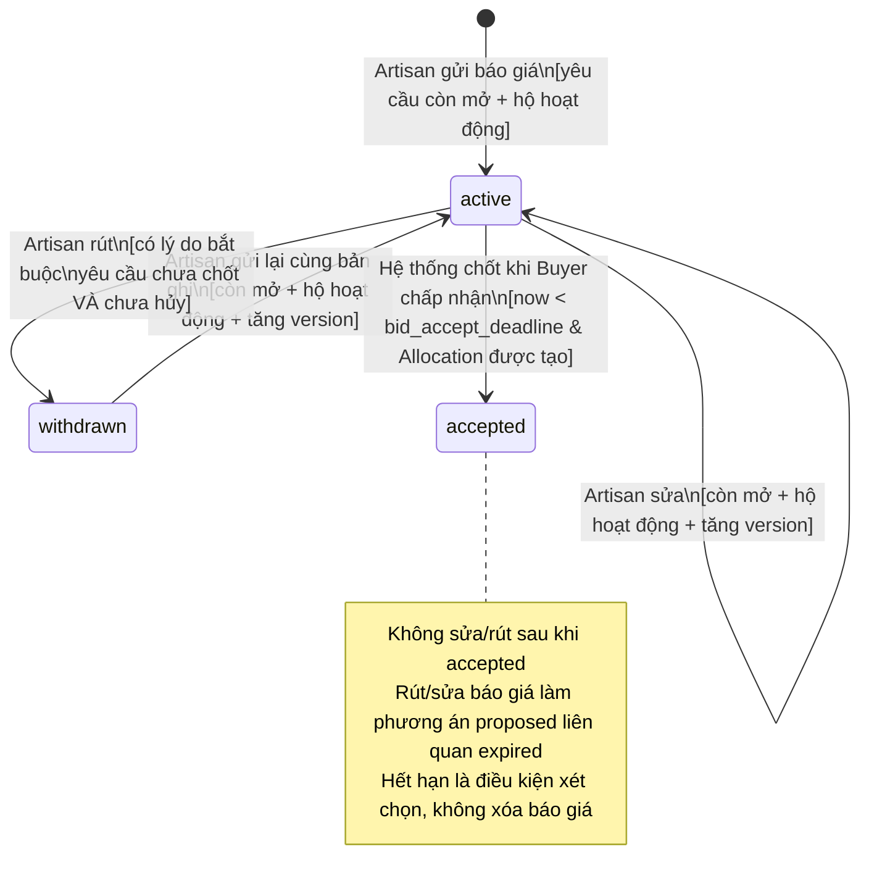
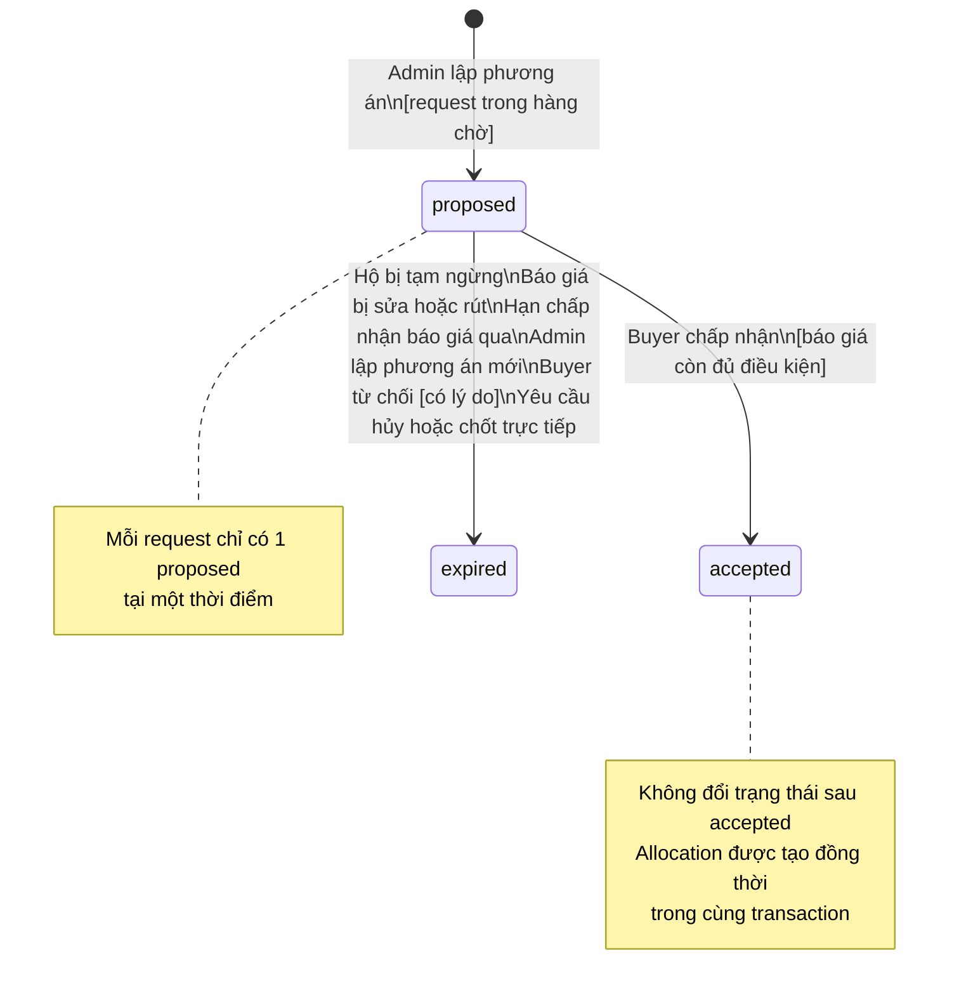

# Thiết kế dữ liệu và trạng thái — vCraft

Căn cứ: [phạm vi dự án](../01-project-brief/project-scope.md), [quy tắc nghiệp vụ](business-rules.md), [use cases](use-cases.md) và [bảo mật & phân quyền](security-and-access-control.md).

Tài liệu này xác định thực thể, thuộc tính, quan hệ, ràng buộc, trạng thái và điều kiện chuyển trạng thái cho toàn bộ hệ thống vCraft MVP.

---

## 1. ERD theo nhóm chức năng

Do số lượng thực thể lớn, ERD được chia thành 3 nhóm để dễ đọc. Sơ đồ chỉ liệt kê thuộc tính chính; từ điển ở mục 2 và ràng buộc ở mục 4 là đặc tả đầy đủ. Các thực thể xuất hiện ở nhiều nhóm là cùng một bảng. Quan hệ ảnh đa hình kiểm tra trong giao dịch, không giả định có FK trực tiếp từ context_id đến nhiều bảng.

### 1.1. Nhóm Xác thực & Hộ sản xuất

### 1.2. Nhóm Danh mục & Trưng bày

### 1.3. Nhóm Yêu cầu & Điều phối đơn hàng

---

## 2. Từ điển dữ liệu

### 2.1. Account — Tài khoản người dùng

| Trường | Kiểu | Null | Ràng buộc / Mô tả |
|--------|------|------|-------------------|
| `id` | bigint | No | PK, auto-increment |
| `username` | varchar(32) | No | Unique sau khi lowercase + trim. 4–32 ký tự ASCII: chữ, số, `.`, `_`. Không tự đổi |
| `password_hash` | varchar(255) | No | Argon2id `m=19MiB,t=2,p=1`; format lưu thông tin thuật toán/tham số. Không lưu bản rõ |
| `display_name` | varchar(100) | Yes | Tên hiển thị; Buyer bắt buộc; Artisan/Admin không dùng trường này |
| `phone` | varchar(20) | Yes | Số điện thoại liên hệ Buyer; chưa xác minh OTP |
| `role` | varchar(10) | No | Enum: `buyer`, `artisan`, `admin`. Server tự gán, không tin client |
| `auth_version` | integer | No | Default 1, > 0; tăng khi đổi/đặt lại mật khẩu, khóa bảo mật hoặc thu hồi toàn bộ phiên |
| `is_login_locked` | boolean | No | Default false. Khóa bảo mật do người vận hành — khác tạm ngừng hộ |
| `temp_password_expires_at` | timestamp | Yes | Hết hạn mật khẩu tạm (24h); null khi đã đổi sang mật khẩu thường |
| `created_at` | timestamp | No | UTC |
| `updated_at` | timestamp | No | UTC |

> **Ràng buộc DB:** `UNIQUE (username)`. `role` chỉ nhận 3 giá trị. Buyer/Admin không có Workshop; Artisan phải có đúng 1 Workshop liên kết. Tạo Account Artisan và Workshop trong cùng giao dịch; kiểm tra vai trò phía máy chủ, không có API đổi vai trò/chủ hộ. Khóa Account khi thay đổi bảo mật; lưu băm mới (nếu có), tăng `auth_version`, thu hồi phiên và SecurityAuditLog trong cùng giao dịch.

---

### 2.2. Workshop — Hộ / Xưởng sản xuất

| Trường | Kiểu | Null | Ràng buộc / Mô tả |
|--------|------|------|-------------------|
| `id` | bigint | No | PK |
| `account_id` | bigint | No | FK → Account (Artisan). Unique — 1 hộ 1 tài khoản |
| `name` | varchar(200) | No | Tên xưởng hiển thị công khai |
| `story` | text | Yes | Câu chuyện làm nghề |
| `address` | varchar(500) | Yes | Địa chỉ xưởng |
| `latitude` | decimal(9,6) | Yes | −90 đến 90; null nếu chưa nhập |
| `longitude` | decimal(9,6) | Yes | −180 đến 180 |
| `accepting_visitors` | boolean | No | Default false; Artisan bật/tắt |
| `avatar_image_id` | bigint | Yes | FK → Image; ảnh đại diện xưởng trên danh mục/bản đồ |
| `status` | varchar(15) | No | Enum: `active`, `suspended`. Default `active` khi tạo |
| `created_at` | timestamp | No | UTC |
| `updated_at` | timestamp | No | UTC |

> **Ràng buộc:** `UNIQUE (account_id)`. Hồ sơ công khai khi `status = active` AND có đủ `name`, `address`, `story`, ≥1 ảnh xưởng. Hồ sơ đủ điều kiện công khai không được sửa xóa trường bắt buộc. Tọa độ phải trong khoảng hợp lệ nếu nhập.

---

### 2.2a. WorkshopStatusLog — Lịch sử trạng thái xưởng

| Trường | Kiểu | Null | Ràng buộc / Mô tả |
|--------|------|------|-------------------|
| `id` | bigint | No | PK |
| `workshop_id` | bigint | No | FK → Workshop |
| `prev_status` | varchar(15) | Yes | Null khi mới tạo hộ ban đầu |
| `new_status` | varchar(15) | No | `active`, `suspended` |
| `performed_by` | bigint | No | FK → Account (Admin) |
| `reason` | text | Yes | Lý do tạm ngừng hoặc mở lại theo BR-05, UC-04 |
| `created_at` | timestamp | No | UTC |

> **Audit log theo SEC-15:** Mọi thao tác Admin tạm ngừng hoặc cho hộ hoạt động lại bắt buộc ghi nhận người thực hiện, thời điểm và lý do. Không cho sửa hoặc xóa lịch sử này.

---

### 2.3. Certificate — Chứng nhận chất lượng

| Trường | Kiểu | Null | Ràng buộc / Mô tả |
|--------|------|------|-------------------|
| `id` | bigint | No | PK |
| `workshop_id` | bigint | No | FK → Workshop |
| `name` | varchar(200) | No | Tên chứng nhận |
| `image_id` | bigint | No | Unique FK → Image — ảnh minh chứng bắt buộc; chủ ảnh phải là Certificate này |
| `created_at` | timestamp | No | UTC |

> Không tự gắn nhãn chứng nhận khi thiếu chứng cứ. Không phải xác nhận chất lượng của Admin.

---

### 2.4. Category — Phân loại sản phẩm

| Trường | Kiểu | Null | Ràng buộc / Mô tả |
|--------|------|------|-------------------|
| `id` | bigint | No | PK |
| `name` | varchar(100) | No | Unique. VD: "Ấm, chén và cốc" |
| `is_active` | boolean | No | Default true. Không xóa phân loại đang được sử dụng |
| `created_at` | timestamp | No | UTC |
| `updated_at` | timestamp | No | UTC |

> **5 phân loại khởi tạo:** Ấm/chén/cốc; Bát/đĩa/khay; Bình/lọ/trang trí; Đồ thờ; Chậu gốm.

---

### 2.5. Product — Sản phẩm

| Trường | Kiểu | Null | Ràng buộc / Mô tả |
|--------|------|------|-------------------|
| `id` | bigint | No | PK |
| `workshop_id` | bigint | No | FK → Workshop |
| `batch_id` | bigint | No | FK → Batch cùng workshop |
| `category_id` | bigint | No | FK → Category |
| `name` | varchar(300) | No | Tên sản phẩm |
| `price` | numeric(15,0) | No | VND, > 0 |
| `description` | text | Yes | Mô tả chi tiết |
| `status` | varchar(10) | No | Enum: `draft`, `published`, `hidden` |
| `published_at` | timestamp | Yes | Thời điểm công bố lần đầu |
| `created_at` | timestamp | No | UTC |
| `updated_at` | timestamp | No | UTC |

> **Điều kiện công bố:** có `name`, `category_id`, `price > 0`, ≥1 ảnh, `batch.status = published`. Không chuyển sản phẩm sang lô khác khi lô hiện tại đã công bố.

---

### 2.6. Batch — Lô sản xuất

| Trường | Kiểu | Null | Ràng buộc / Mô tả |
|--------|------|------|-------------------|
| `id` | bigint | No | PK |
| `workshop_id` | bigint | No | FK → Workshop |
| `name` | varchar(200) | No | Tên lô |
| `qr_token` | varchar(64) | No | Unique, random khó đoán; dùng trong URL QR công khai |
| `status` | varchar(10) | No | Enum: `draft`, `published`. Không quay lại draft |
| `published_at` | timestamp | Yes | UTC |
| `created_at` | timestamp | No | UTC |
| `updated_at` | timestamp | No | UTC |

> **Điều kiện công bố:** ≥1 JournalEntry hợp lệ. Không xóa lô đã công bố hoặc lô đã dùng trong Allocation.

---

### 2.7. JournalEntry — Mốc nhật ký sản xuất

| Trường | Kiểu | Null | Ràng buộc / Mô tả |
|--------|------|------|-------------------|
| `id` | bigint | No | PK |
| `batch_id` | bigint | No | FK → Batch |
| `performed_by` | bigint | No | FK → Account (Artisan của hộ) |
| `stage` | varchar(200) | No | Công đoạn thực tế; VD: "Tạo hình", "Nung" |
| `performed_at` | timestamp | No | Thời điểm thực hiện công đoạn (do Artisan nhập) |
| `notes` | text | Yes | Ghi chú bổ sung |
| `created_at` | timestamp | No | UTC |
| `updated_at` | timestamp | No | UTC |

> **Ràng buộc:** ≥1 ảnh đính kèm qua Image. Lô nháp: thêm/sửa/xóa. Lô đã công bố: thêm/sửa, **không xóa**. Sửa lô đã công bố phải tạo JournalEditHistory trước khi cập nhật.

---

### 2.8. JournalEditHistory — Lịch sử sửa nhật ký

| Trường | Kiểu | Null | Ràng buộc / Mô tả |
|--------|------|------|-------------------|
| `id` | bigint | No | PK |
| `journal_entry_id` | bigint | No | FK → JournalEntry |
| `edited_by` | bigint | No | FK → Account |
| `prev_stage` | varchar(200) | No | Nội dung công đoạn trước khi sửa |
| `prev_performed_at` | timestamp | No | Thời điểm thực hiện trước khi sửa |
| `prev_notes` | text | Yes | Ghi chú trước khi sửa |
| `edited_at` | timestamp | No | Thời điểm hệ thống ghi nhận sửa |

> **Không có API xóa** JournalEditHistory. Ảnh tham chiếu qua `JournalHistoryImage` không được dọn dù không còn gắn trực tiếp (BR-08).

---

### 2.9. NewsPost — Tin tức cộng đồng

| Trường | Kiểu | Null | Ràng buộc / Mô tả |
|--------|------|------|-------------------|
| `id` | bigint | No | PK |
| `created_by` | bigint | No | FK → Account (Admin) |
| `updated_by` | bigint | Yes | FK → Account (Admin sửa/gỡ tin gần nhất) |
| `title` | varchar(300) | No | Tiêu đề |
| `content` | text | No | Nội dung |
| `post_type` | varchar(30) | No | Enum: `material`, `power_schedule`, `support_policy`, `announcement` |
| `status` | varchar(10) | No | Enum: `draft`, `published` |
| `published_at` | timestamp | Yes | UTC |
| `created_at` | timestamp | No | UTC |
| `updated_at` | timestamp | No | UTC |

---

### 2.10. QuoteRequest — Yêu cầu báo giá / Đơn hàng

| Trường | Kiểu | Null | Ràng buộc / Mô tả |
|--------|------|------|-------------------|
| `id` | bigint | No | PK |
| `buyer_id` | bigint | No | FK → Account (Buyer) |
| `category_id` | bigint | Yes | FK → Category; bắt buộc khi gửi |
| `spec` | text | Yes | Quy cách gốm (kích thước, màu men, họa tiết, đóng gói…) |
| `quantity` | integer | Yes | Số lượng nguyên dương nếu nhập; bắt buộc khi gửi |
| `unit` | varchar(10) | Yes | Enum: `piece` (chiếc), `set` (bộ) |
| `unit_set_description` | text | Yes | Mô tả thành phần 1 bộ; bắt buộc khi gửi và `unit = set` |
| `status` | varchar(25) | No | Enum: `Draft Request`, `Sent to Artisans`, `Artisans Bidding`, `Buyer Accepted`, `In Production`, `Delivered` |
| `delivery_mode` | varchar(20) | Yes | Enum: `at_workshop`, `at_buyer_address` |
| `delivery_region` | varchar(200) | Yes | Tỉnh/thành phố + xã/phường (khái quát); bắt buộc khi gửi và `delivery_mode = at_buyer_address` |
| `delivery_address` | text | Yes | Địa chỉ giao chi tiết; bắt buộc khi gửi và `delivery_mode = at_buyer_address` |
| `recipient_name` | varchar(200) | Yes | Tên người nhận; bắt buộc khi gửi |
| `recipient_phone` | varchar(20) | Yes | SĐT người nhận; bắt buộc khi gửi |
| `bidding_deadline` | timestamp | Yes | Hạn nhận báo giá; lưu UTC, hiển thị UTC+7; bắt buộc khi gửi |
| `delivery_deadline` | timestamp | Yes | Hạn giao hàng; bắt buộc khi gửi |
| `bidding_closed_at` | timestamp | Yes | Thời điểm đóng thực tế (đóng sớm hoặc = bidding_deadline) |
| `split_requested_at` | timestamp | Yes | Thời điểm Buyer nhờ Admin chia đơn |
| `version` | integer | No | Default 1; tăng khi sửa nháp, gửi, đóng nhận, nhờ chia, chốt, đổi trạng thái, hủy hoặc sửa liên hệ |
| `cancelled_at` | timestamp | Yes | UTC |
| `cancelled_by` | bigint | Yes | FK → Account |
| `cancel_reason` | text | Yes | Bắt buộc khi Admin hủy |
| `created_at` | timestamp | No | UTC |
| `updated_at` | timestamp | No | UTC |

> **Bất biến sau khi gửi:** `category_id`, `spec`, `quantity`, `unit`, `unit_set_description`, `delivery_mode`, `delivery_region`, `delivery_address`, `bidding_deadline`, `delivery_deadline`. Chỉ `recipient_name`, `recipient_phone` được sửa khi chưa hủy/Delivered, có lịch sử (BR-11).

> **Nháp và gửi:** Nháp được thiếu dữ liệu; không dùng giá trị giả để thay null. CHECK có điều kiện theo status bảo đảm các trường bắt buộc khác null, chuỗi không rỗng khi đã gửi; `unit = set` cần mô tả bộ, giao tại địa chỉ Buyer cần khu vực và địa chỉ chi tiết. Khi gửi, khóa yêu cầu, kiểm tra phiên bản, phân loại hoạt động, `now < bidding_deadline` và `delivery_deadline > bidding_deadline + 24h`; chụp danh sách hộ phù hợp trong cùng giao dịch. Không có hộ phù hợp thì giữ nháp. Nháp chỉ xóa, không hủy.

> **Quyền đọc:** Tên/SĐT/địa chỉ chi tiết và lịch sử liên hệ chỉ trả cho Buyer sở hữu, Admin và hộ có Allocation của yêu cầu theo SEC-06; danh sách nhận không cấp quyền liên hệ. Hộ chưa được chốt chỉ nhận dữ liệu quy cách, số lượng, thời hạn, hình thức và khu vực khái quát. Nhãn “Không còn báo giá hợp lệ” được tính khi đọc cho Buyer/Admin, không thêm trạng thái hoặc lùi trạng thái.

---

### 2.11. ContactEditHistory — Lịch sử sửa thông tin người nhận

| Trường | Kiểu | Null | Ràng buộc / Mô tả |
|--------|------|------|-------------------|
| `id` | bigint | No | PK |
| `request_id` | bigint | No | FK → QuoteRequest |
| `edited_by` | bigint | No | FK → Account (Buyer sở hữu) |
| `prev_recipient_name` | varchar(200) | No | Tên cũ |
| `prev_recipient_phone` | varchar(20) | No | SĐT cũ |
| `new_recipient_name` | varchar(200) | No | Tên mới |
| `new_recipient_phone` | varchar(20) | No | SĐT mới |
| `edited_at` | timestamp | No | UTC |
| `version` | integer | No | Phiên bản QuoteRequest tại thời điểm sửa |

---

### 2.12. RequestRecipient — Hộ nhận yêu cầu

| Trường | Kiểu | Null | Ràng buộc / Mô tả |
|--------|------|------|-------------------|
| `id` | bigint | No | PK |
| `request_id` | bigint | No | FK → QuoteRequest |
| `workshop_id` | bigint | No | FK → Workshop |
| `response_status` | varchar(15) | No | Enum: `pending`, `declined`, `quoted`, `withdrawn` |
| `decline_reason` | text | Yes | Lý do không tham gia (tùy chọn) |
| `responded_by` | bigint | Yes | FK → Account (Artisan của hộ) |
| `responded_at` | timestamp | Yes | UTC |
| `sent_at` | timestamp | No | Thời điểm hệ thống gửi yêu cầu đến hộ |
| `version` | integer | No | Default 1; tăng khi phản hồi thay đổi |

> **Unique:** `(request_id, workshop_id)`. Điều kiện nhận yêu cầu: hộ đang hoạt động và có ≥1 sản phẩm đã công bố đúng phân loại. Không tự thêm/xóa sau khi đã gửi. Mỗi thay đổi phản hồi ghi RecipientResponseHistory cùng giao dịch; các trường phản hồi ở đây chỉ là giá trị hiện tại. Bỏ qua không tạo phản hồi hay dấu đã đọc. Chỉ được từ chối khi chưa từng có Quote và yêu cầu còn mở; từ chối rồi gửi báo giá được phép nếu vẫn đủ điều kiện.

---

### 2.13. Quote — Báo giá

| Trường | Kiểu | Null | Ràng buộc / Mô tả |
|--------|------|------|-------------------|
| `id` | bigint | No | PK |
| `request_id` | bigint | No | FK → QuoteRequest |
| `workshop_id` | bigint | No | FK → Workshop |
| `unit_price` | numeric(15,0) | No | VND, > 0; chỉ tiền hàng, không bao gồm vận chuyển |
| `max_quantity` | integer | No | ≤ `request.quantity`, nguyên dương |
| `bid_accept_deadline` | timestamp | No | Phải ≥ `request.bidding_deadline + 24h` AND < `committed_delivery_at` |
| `committed_delivery_at` | timestamp | No | ≤ `request.delivery_deadline` |
| `status` | varchar(10) | No | Enum: `active`, `withdrawn`, `accepted` |
| `version` | integer | No | Default 1; tăng mỗi lần sửa, rút, gửi lại hoặc chốt |
| `withdraw_reason` | text | Yes | Bắt buộc khi rút |
| `withdrawn_by` | bigint | Yes | FK → Account (Artisan) |
| `withdrawn_at` | timestamp | Yes | UTC |
| `created_at` | timestamp | No | UTC |
| `updated_at` | timestamp | No | UTC |

> **Unique:** `(request_id, workshop_id)`. FK ghép `(request_id, workshop_id)` → RequestRecipient để chỉ hộ đã nhận được chào giá. `UNIQUE(id, request_id, workshop_id)` phục vụ FK ghép của phương án/phần việc. Gửi lại dùng chính bản ghi Quote hiện có; trước khi thay đổi phải ghi lịch sử (mục 2.23). **Điều kiện đủ để xét chọn:** `status = active` AND `workshop.status = active` AND `now() < bid_accept_deadline` AND `committed_delivery_at ≤ delivery_deadline`; yêu cầu chưa hủy/chốt. Khi gửi/sửa/gửi lại còn phải kiểm tra yêu cầu mở nhận và `now < bid_accept_deadline`, số lượng/đơn giá hợp lệ.

---

### 2.14. SplitProposal — Phương án chia đơn

| Trường | Kiểu | Null | Ràng buộc / Mô tả |
|--------|------|------|-------------------|
| `id` | bigint | No | PK |
| `request_id` | bigint | No | FK → QuoteRequest |
| `created_by` | bigint | No | FK → Account (Admin) |
| `status` | varchar(10) | No | Enum: `proposed`, `accepted`, `expired` |
| `version` | integer | No | Default 1 |
| `expired_at` | timestamp | Yes | Thời điểm hết hiệu lực; nếu do hạn thì dùng hạn sớm nhất liên quan |
| `expire_reason` | varchar(40) | Yes | Bắt buộc khi expired: `quote_changed`, `quote_withdrawn`, `quote_expired`, `workshop_suspended`, `replaced`, `buyer_rejected`, `request_accepted`, `request_cancelled` |
| `reject_reason` | text | Yes | Lý do từ chối của Buyer; bắt buộc khi Buyer từ chối |
| `rejected_by` | bigint | Yes | FK → Account (Buyer) |
| `rejected_at` | timestamp | Yes | UTC |
| `created_at` | timestamp | No | UTC |
| `updated_at` | timestamp | No | UTC |

> **Ràng buộc:** Mỗi request chỉ có 1 phương án `proposed` tại một thời điểm. Dùng unique index có điều kiện trên `request_id WHERE status = proposed`. Không đổi trạng thái/nội dung phương án đã `accepted`. Mỗi lần lập lại tạo bản ghi mới, chuyển bản cũ sang `expired` và giữ lịch sử trong cùng giao dịch; không tái sử dụng bản ghi cũ. `UNIQUE(id, request_id)` phục vụ FK ghép.

---

### 2.15. SplitProposalItem — Chi tiết phân bổ trong phương án

| Trường | Kiểu | Null | Ràng buộc / Mô tả |
|--------|------|------|-------------------|
| `id` | bigint | No | PK |
| `request_id` | bigint | No | FK ghép cùng proposal_id/quote_id, bảo đảm cùng yêu cầu |
| `quote_version` | integer | No | Phiên bản báo giá tại lúc lập; kiểm tra lại khi chấp nhận |
| `proposal_id` | bigint | No | FK → SplitProposal |
| `workshop_id` | bigint | No | FK → Workshop |
| `quote_id` | bigint | No | FK → Quote |
| `allocated_quantity` | integer | No | Nguyên dương; ≤ `quote.max_quantity` |

> **Ràng buộc:** ≥2 item/phương án. Unique `(proposal_id, workshop_id)`. `SUM(allocated_quantity) = request.quantity`. FK `(proposal_id, request_id)` → SplitProposal `(id, request_id)`; FK `(quote_id, request_id, workshop_id)` → Quote `(id, request_id, workshop_id)`.

---

### 2.16. Allocation — Phần việc của từng hộ

| Trường | Kiểu | Null | Ràng buộc / Mô tả |
|--------|------|------|-------------------|
| `id` | bigint | No | PK |
| `request_id` | bigint | No | FK → QuoteRequest |
| `workshop_id` | bigint | No | FK → Workshop |
| `quote_id` | bigint | No | FK → Quote (nguồn gốc báo giá) |
| `quantity` | integer | No | Chốt cố định khi tạo |
| `unit_price` | numeric(15,0) | No | Chốt cố định khi tạo |
| `committed_delivery_at` | timestamp | No | Chốt cố định khi tạo |
| `status` | varchar(20) | No | Enum: `not_started`, `in_production`, `handed_over` |
| `version` | integer | No | Default 1; tăng khi đổi trạng thái hoặc liên kết lô |
| `started_at` | timestamp | Yes | UTC |
| `started_by` | bigint | Yes | FK → Account (Artisan) |
| `handed_over_at` | timestamp | Yes | UTC; thời điểm hệ thống ghi nhận bàn giao |
| `handed_over_by` | bigint | Yes | FK → Account (Artisan hoặc Admin) |
| `delivery_note` | text | Yes | Ghi chú bàn giao |
| `admin_handed_over` | boolean | No | Default false; true khi Admin ghi nhận thay |
| `admin_delivery_evidence` | text | Yes | Căn cứ đã xác minh; bắt buộc khi Admin ghi nhận thay |
| `admin_handover_reason` | text | Yes | Bắt buộc khi `admin_handed_over = true` |
| `admin_handover_actual_at` | timestamp | Yes | Thời điểm bàn giao thực tế do Admin xác nhận (không ở tương lai) |
| `created_at` | timestamp | No | UTC |
| `updated_at` | timestamp | No | UTC |

> **Bất biến sau tạo:** `quantity`, `unit_price`, `committed_delivery_at`, `workshop_id`, `request_id`, `quote_id`. `UNIQUE(request_id, workshop_id)` và `UNIQUE(quote_id)`; FK `(quote_id, request_id, workshop_id)` → Quote `(id, request_id, workshop_id)`. Admin chỉ ghi nhận thay khi `status = in_production`.

---

### 2.17. AllocationBatch — Liên kết phần việc ↔ lô truy xuất

| Trường | Kiểu | Null | Ràng buộc / Mô tả |
|--------|------|------|-------------------|
| `id` | bigint | No | PK |
| `workshop_id` | bigint | No | Hộ của phần việc/lô; dùng hai FK ghép tại mục 4.1 |
| `allocation_id` | bigint | No | FK → Allocation |
| `batch_id` | bigint | No | FK → Batch (cùng workshop) |
| `linked_quantity` | integer | No | Nguyên dương; đóng góp vào tổng liên kết |
| `linked_at` | timestamp | No | UTC |
| `linked_by` | bigint | No | FK → Account (Artisan) |

> **Ràng buộc:** `SUM(linked_quantity) ≤ allocation.quantity`. Batch phải cùng Workshop. Không đổi sau `allocation.status = handed_over`. Unique `(allocation_id, batch_id)`. **Thiếu liên kết không chặn** ghi nhận bàn giao — chỉ hiển thị cảnh báo.

---

### 2.18. AllocationLog — Lịch sử trạng thái phần việc

| Trường | Kiểu | Null | Ràng buộc / Mô tả |
|--------|------|------|-------------------|
| `id` | bigint | No | PK |
| `allocation_id` | bigint | No | FK → Allocation |
| `event_type` | varchar(40) | No | Loại sự kiện do server gán; xem mục 4.2 |
| `evidence` | text | Yes | Căn cứ bắt buộc khi Admin ghi nhận/xác nhận thay |
| `prev_status` | varchar(20) | Yes | Null khi tạo mới |
| `new_status` | varchar(20) | No | Trạng thái mới |
| `performed_by` | bigint | No | FK → Account |
| `note` | text | Yes | Lý do/căn cứ; bắt buộc khi Admin ghi nhận thay |
| `is_admin_action` | boolean | No | Default false |
| `created_at` | timestamp | No | UTC |

---

### 2.19. StatusLog — Lịch sử trạng thái yêu cầu

| Trường | Kiểu | Null | Ràng buộc / Mô tả |
|--------|------|------|-------------------|
| `id` | bigint | No | PK |
| `request_id` | bigint | No | FK → QuoteRequest |
| `event_type` | varchar(40) | No | Loại sự kiện do server gán; xem mục 4.2 |
| `evidence` | text | Yes | Căn cứ bắt buộc khi Admin ghi nhận/xác nhận thay |
| `prev_status` | varchar(25) | Yes | Null khi tạo draft |
| `new_status` | varchar(25) | No | Trạng thái mới |
| `performed_by` | bigint | Yes | FK → Account; null khi hệ thống tự chuyển |
| `note` | text | Yes | Lý do hủy, căn cứ xác nhận thay… |
| `is_admin_action` | boolean | No | Default false |
| `created_at` | timestamp | No | UTC |

> **Bắt buộc** ghi trong cùng transaction với mọi thay đổi trạng thái. Sự kiện hủy giữ `prev_status = new_status`, phân biệt bằng `event_type = cancelled`. Admin xác nhận thay dùng `received_by_admin`, lưu người thực hiện thật, lý do ở note và căn cứ ở evidence; Buyer được xem nhãn “Admin thực hiện thay” cùng thông tin này. Nếu thất bại → rollback toàn bộ (BR-26, SEC-13).

---

### 2.20. Image — Ảnh đã xử lý

| Trường | Kiểu | Null | Ràng buộc / Mô tả |
|--------|------|------|-------------------|
| `id` | bigint | No | PK |
| `uploaded_by` | bigint | No | FK → Account |
| `context_type` | varchar(30) | No | Enum: `workshop_profile`, `certificate`, `product`, `journal_entry` |
| `context_id` | bigint | Yes | ID chủ sở hữu; có thể null khi chờ gắn đối tượng mới; cố định từ lần gắn đầu |
| `storage_key` | varchar(255) | Yes | Unique; key ngẫu nhiên trong kho lưu trữ — không dùng tên gốc |
| `thumbnail_key` | varchar(255) | No | Key ảnh thumbnail ≤320px cạnh dài |
| `display_key` | varchar(255) | No | Key ảnh hiển thị ≤1600px cạnh dài |
| `original_size_bytes` | integer | No | Dung lượng bản gốc còn giữ; 0 nếu không giữ |
| `thumbnail_size_bytes` | bigint | No | Byte thực của thumbnail |
| `display_size_bytes` | bigint | No | Byte thực của bản hiển thị |
| `quota_id` | bigint | No | FK → StorageQuota; chủ quota cố định theo ngữ cảnh hộ/tài khoản |
| `reservation_id` | bigint | No | Unique FK → UploadReservation |
| `width` | integer | No | Chiều rộng ảnh gốc (px) |
| `height` | integer | No | Chiều cao ảnh gốc (px) |
| `unreferenced_at` | timestamp | Yes | UTC bắt đầu không còn tham chiếu; ảnh mới chờ gắn lấy created_at, có tham chiếu thì null |
| `storage_state` | varchar(15) | No | `ready`, `deleting`; chỉ ảnh ready được gắn/đọc; dọn lỗi giữ deleting để thử lại |
| `is_attached` | boolean | No | Default false; đang được nội dung hiện hành tham chiếu; bỏ gắn không xóa chủ sở hữu |
| `created_at` | timestamp | No | UTC |

> Dọn ảnh không còn tham chiếu hiện hành/lịch sử sau 24 giờ không được tham chiếu (theo `unreferenced_at`). Không dọn ảnh được tham chiếu trong JournalHistoryImage. Một image_id chỉ thuộc một đối tượng; không chuyển chủ hoặc dùng chung cho đối tượng khác. Lịch sử chỉ tham chiếu ảnh cùng JournalEntry, không đổi context thành lịch sử. Quyền đọc phụ thuộc ngữ cảnh hiện hành/lịch sử của URL; ảnh hiện hành công khai không làm lịch sử công khai. Chỉ tạo Image khi xử lý thành công; khóa quota và đối tượng khi gắn/gỡ ảnh, không để dọn ảnh đua với tạo tham chiếu. Kho lưu trữ không có quyền truy cập công khai trực tiếp — mọi truy cập qua cổng kiểm tra quyền phía server (SEC-10).

---

### 2.21. Session — Phiên đăng nhập

| Trường | Kiểu | Null | Ràng buộc / Mô tả |
|--------|------|------|-------------------|
| `id` | varchar(64) | No | PK nội bộ |
| `account_id` | bigint | No | FK → Account |
| `session_hash` | varchar(255) | No | Unique; hash của session token thực tế |
| `auth_version` | integer | No | Bản chụp Account.auth_version khi tạo phiên |
| `level` | varchar(15) | No | Enum: `normal`, `temp_password` |
| `created_at` | timestamp | No | UTC |
| `last_active_at` | timestamp | No | Cập nhật mỗi request |
| `expires_at` | timestamp | No | `normal`: 12h từ tạo; `temp_password`: 15 phút |
| `is_revoked` | boolean | No | Default false; true sau đăng xuất/đổi mật khẩu |

> Session token thực tế (≥256 bit entropy) chỉ tồn tại trong cookie `__Host-vcraft-session; Secure; HttpOnly; SameSite=Lax`. Chỉ lưu hash. Không lưu token trong URL, localStorage, sessionStorage. Xác minh mật khẩu ngoài khóa; trước tạo phiên khóa Account rồi kiểm tra lại auth_version, trạng thái khóa và hạn mật khẩu tạm. Request riêng tư chỉ chấp nhận phiên có auth_version khớp Account. Kho phiên khách trước đăng nhập tách riêng, cookie riêng, TTL 15 phút; không tạo Session với account_id null. Nếu dùng cache phiên, auth_version trong DB vẫn là căn cứ thu hồi, không phụ thuộc thành công của xóa cache.

---

### 2.22. IdempotencyRecord — Ghi nhận thao tác đã thực hiện (BR-27)

| Trường | Kiểu | Null | Ràng buộc / Mô tả |
|--------|------|------|-------------------|
| `id` | bigint | No | PK |
| `idempotency_key` | varchar(128) | No | Do client tạo; duy nhất trong phạm vi thao tác bên dưới |
| `request_fingerprint` | varchar(64) | No | SHA-256 của đầu vào chuẩn hóa gồm payload và phiên bản kỳ vọng; không lưu mật khẩu/token |
| `account_id` | bigint | No | FK → Account |
| `action` | varchar(50) | No | VD: `accept_quote`, `deliver_allocation` |
| `object_type` | varchar(30) | No | VD: `quote_request`, `allocation` |
| `object_id` | bigint | No | ID đối tượng |
| `result_snapshot` | jsonb | No | Kết quả đã lưu; trả lại khi gửi lặp đúng nội dung |
| `created_at` | timestamp | No | UTC |
| `expires_at` | timestamp | No | TTL; dọn sau khi hết hạn |

> **Unique:** `(account_id, action, object_type, object_id, idempotency_key)`. Cùng khóa khác fingerprint trả 409, không thực thi lại. Bản ghi kết quả và thay đổi nghiệp vụ commit cùng giao dịch; yêu cầu cạnh tranh cùng khóa chờ giao dịch trước rồi đọc kết quả hoặc thử lại nếu rollback. Không commit bản ghi thành công khi nghiệp vụ thất bại. TTL khởi điểm 24 giờ, dọn nền; hết TTL vẫn kiểm tra trạng thái và ràng buộc duy nhất, không thực thi lại thao tác đã hoàn tất.

> Không trả kết quả của tài khoản khác dù biết key. Khi trả lại kết quả vẫn lọc theo quyền hiện tại.

---

### 2.23. RecipientResponseHistory — Lịch sử phản hồi và báo giá

| Trường | Kiểu | Null | Ràng buộc / Mô tả |
|--------|------|------|-------------------|
| `id` | bigint | No | PK |
| `recipient_id` | bigint | No | FK → RequestRecipient |
| `quote_id` | bigint | Yes | FK → Quote cùng request/workshop; null nếu chưa từng chào giá |
| `event_type` | varchar(30) | No | `declined`, `quote_submitted`, `quote_updated`, `quote_withdrawn`, `quote_resubmitted`, `quote_accepted` |
| `prev_status` | varchar(15) | No | Phản hồi trước thay đổi |
| `new_status` | varchar(15) | No | Phản hồi sau thay đổi |
| `reason` | text | Yes | Lý do từ chối/rút; rút bắt buộc có lý do |
| `quote_snapshot` | jsonb | Yes | Bản chụp giá, số lượng, hạn chấp nhận/giao, trạng thái và version sau sự kiện báo giá |
| `performed_by` | bigint | No | FK → Account; người thực hiện thật, kể cả Buyer khi chấp nhận |
| `created_at` | timestamp | No | UTC do server ghi |

> Chỉ ghi nối tiếp, không có API sửa/xóa. Ghi đồng thời với RequestRecipient/Quote; mọi lần tạo/sửa/rút/gửi lại/chốt Quote đều lưu bản chụp để tái dựng lịch sử. Trước khi xóa các trường rút hiện tại khi gửi lại, lịch sử lần rút phải đã được lưu. Artisan chỉ xem lịch sử phản hồi của mình; Buyer sở hữu/Admin xem theo quyền yêu cầu.

---

### 2.24. JournalHistoryImage — Ảnh trong phiên bản nhật ký

| Trường | Kiểu | Null | Ràng buộc / Mô tả |
|--------|------|------|-------------------|
| `history_id` | bigint | No | FK → JournalEditHistory; thành phần PK |
| `image_id` | bigint | No | FK → Image; thành phần PK |
| `position` | integer | No | Thứ tự ảnh trước khi sửa, ≥ 0 |

> PK `(history_id, image_id)`, UNIQUE `(history_id, position)`. Một phiên bản giữ ít nhất một ảnh. Khi sửa nhật ký đã công bố, khóa JournalEntry, tạo lịch sử nội dung và các tham chiếu ảnh trước sửa rồi cập nhật nội dung hiện hành trong cùng giao dịch. Kiểm tra Image có `context_type = journal_entry`, `context_id = history.journal_entry_id`; không chuyển chủ ảnh. FK chặn xóa ảnh có lịch sử tham chiếu. Chỉ Artisan chủ lô/Admin đọc lịch sử, kể cả khi cùng ảnh vẫn đang công khai ở nội dung hiện hành.

---

### 2.25. SecurityAuditLog — Nhật ký thay đổi bảo mật

| Trường | Kiểu | Null | Ràng buộc / Mô tả |
|--------|------|------|-------------------|
| `id` | bigint | No | PK |
| `actor_id` | bigint | Yes | FK → Account; null cho tác vụ hệ thống/thiết lập ban đầu |
| `target_account_id` | bigint | No | FK → Account chịu tác động |
| `event_type` | varchar(40) | No | Cấp tài khoản, đổi/đặt lại mật khẩu, khóa/mở khóa bảo mật, tạo/thu hồi phiên |
| `reason` | text | Yes | Lý do xử lý theo SEC-05 |
| `verification_evidence` | text | Yes | Bắt buộc cho đặt lại mật khẩu: phương thức, căn cứ xác minh ngoài hệ thống |
| `ip_address` | varchar(45) | Yes | IP tin cậy thực hiện thao tác theo SEC-15 |
| `auth_version_before` | integer | Yes | Phiên bản trước sự kiện; null khi cấp mới |
| `auth_version_after` | integer | No | Phiên bản sau sự kiện |
| `created_at` | timestamp | No | UTC do server ghi |

> Ghi cùng giao dịch với thay đổi bảo mật; lỗi ghi bắt buộc phải rollback. Không lưu mật khẩu tạm, hash mật khẩu, session token hay bản sao giấy tờ xác minh. Log chỉ đọc theo quyền vận hành bảo mật, không đưa vào lịch sử đơn cho Buyer/Artisan khác; không có API sửa/xóa. Log đăng nhập thất bại/rate-limit dùng kho log vận hành có giới hạn theo SEC-15, không tạo Account giả cho tên đăng nhập không tồn tại.

---

### 2.26. StorageQuota — Sổ dung lượng theo chủ quota

| Trường | Kiểu | Null | Ràng buộc / Mô tả |
|--------|------|------|-------------------|
| `id` | bigint | No | PK |
| `workshop_id` | bigint | Yes | Unique FK → Workshop; dùng cho ảnh thuộc hộ |
| `account_id` | bigint | Yes | Unique FK → Account; chỉ cho ngữ cảnh ngoài hộ được phép upload |
| `limit_bytes` | bigint | No | 2 GiB/hộ hoặc 1 GiB/tài khoản ngoài hộ theo SEC-14 |
| `used_bytes` | bigint | No | Default 0; byte thực còn lưu của ảnh gốc nếu giữ, thumbnail, display, ảnh chờ gắn và lịch sử |
| `reserved_bytes` | bigint | No | Default 0; tổng ngân sách upload chưa quyết toán |
| `updated_at` | timestamp | No | UTC |

> CHECK đúng một trong workshop_id/account_id khác null; các số byte không âm và `used_bytes + reserved_bytes <= limit_bytes`. Admin upload khởi tạo hộ tính vào quota hộ, không tính vào tài khoản Admin. Có quota không cấp thêm quyền upload. Dùng khóa hàng khi đặt trước/quyết toán; định kỳ đối soát với tệp thực tế. Mỗi tệp vật lý chỉ tính một lần dù có nhiều tham chiếu lịch sử; bản sao độc lập tính riêng.

---

### 2.27. UploadReservation — Giữ chỗ dung lượng upload

| Trường | Kiểu | Null | Ràng buộc / Mô tả |
|--------|------|------|-------------------|
| `id` | bigint | No | PK |
| `quota_id` | bigint | No | FK → StorageQuota |
| `uploaded_by` | bigint | No | FK → Account |
| `context_type` | varchar(30) | No | Ngữ cảnh đích được phép như Image |
| `context_id` | bigint | Yes | Đối tượng đích; null chỉ khi chuẩn bị tạo đối tượng mới |
| `budget_bytes` | bigint | No | Ngân sách tối đa, khởi điểm 16 MiB/ảnh |
| `actual_bytes` | bigint | Yes | Byte thực sau xử lý; không vượt budget |
| `status` | varchar(20) | No | `reserved`, `committed`, `cleanup_pending`, `released` |
| `storage_prefix` | varchar(255) | No | Unique; vùng tệp riêng để đối soát/dọn cả tệp tạm |
| `expires_at` | timestamp | No | Hạn xử lý/lease theo cấu hình timeout worker |
| `created_at` | timestamp | No | UTC |
| `updated_at` | timestamp | No | UTC |

> Trước nhận tệp, đặt trước quota và dung lượng kho dùng chung nguyên tử. Worker không ghi vượt budget, kể cả tệp tạm/trung gian. Thành công: dọn tệp tạm, tạo Image, chuyển reservation sang committed và chuyển ngân sách sang byte thực cùng giao dịch DB. Không giữ khóa DB trong lúc xử lý ảnh. Thất bại/timeout: chuyển cleanup_pending, chỉ chuyển released và giải phóng ngân sách sau xác nhận dọn sạch. Dùng trạng thái/lease có điều kiện để worker cũ không commit sau khi tác vụ dọn đã nhận quyền xử lý. Dọn hoặc quyết toán lặp không cộng/trừ lần hai.

> Kho tệp không tham gia transaction DB: giữ reservation khi chưa chắc đã dọn, đối soát theo storage_prefix sau crash. Mọi worker dùng chung bộ điều phối dung lượng; khóa kho trước rồi quota theo thứ tự cố định khi nhận/giải phóng ngân sách. Giữ trống tối thiểu `max(2 GiB, 10% dung lượng volume)` sau đặt trước; kiểm tra dung lượng thực và ngân sách chưa phản ánh vào tệp, không chỉ quota từng hộ. Không xóa ảnh đang được tham chiếu để nhận upload mới. Thiếu quota trả 409 `STORAGE_QUOTA_EXCEEDED`, thiếu dung lượng kho trả 503 `STORAGE_CAPACITY_LOW`.

---

## 3. Sơ đồ trạng thái

### 3.1. QuoteRequest — Yêu cầu báo giá

---

### 3.2. Allocation — Phần việc

---

### 3.3. Batch — Lô sản xuất

---

### 3.4. Product — Sản phẩm

---

### 3.5. Workshop — Hộ sản xuất

---

### 3.6. Quote — Báo giá

---

### 3.7. SplitProposal — Phương án chia đơn

---

## 4. Ràng buộc dữ liệu và giao dịch

### 4.1. Ràng buộc khai báo ở DB

| Cơ chế | Ràng buộc |
|--------|-----------|
| UNIQUE | Account.username sau lowercase/trim; Workshop.account_id; Batch.qr_token; Session.session_hash; Certificate.image_id |
| UNIQUE | RequestRecipient(request_id, workshop_id); Quote(request_id, workshop_id); Allocation(request_id, workshop_id); Allocation.quote_id |
| UNIQUE | SplitProposalItem(proposal_id, workshop_id); AllocationBatch(allocation_id, batch_id); phạm vi IdempotencyRecord tại mục 2.22 |
| UNIQUE có điều kiện | SplitProposal(request_id) khi status = proposed; phương án hết hạn vẫn giữ bản ghi |
| Khóa đích cho FK ghép | Quote(id, request_id, workshop_id); SplitProposal(id, request_id); Batch(id, workshop_id); Allocation(id, workshop_id) |
| FK ghép | Quote(request_id, workshop_id) → RequestRecipient(request_id, workshop_id) |
| FK ghép | SplitProposalItem(proposal_id, request_id) → SplitProposal(id, request_id); (quote_id, request_id, workshop_id) → Quote(id, request_id, workshop_id) |
| FK ghép | Allocation(quote_id, request_id, workshop_id) → Quote(id, request_id, workshop_id) |
| FK ghép | Product(batch_id, workshop_id) → Batch(id, workshop_id); AllocationBatch(allocation_id, workshop_id) → Allocation(id, workshop_id) và (batch_id, workshop_id) → Batch(id, workshop_id) |
| CHECK cùng dòng | Enum trạng thái/vai trò, version > 0; quantity/max_quantity/allocated_quantity/linked_quantity > 0; price/unit_price > 0; tọa độ trong khoảng hợp lệ |
| CHECK nháp có điều kiện | QuoteRequest.status khác Draft Request thì đủ các trường bắt buộc; khi còn nháp cho null nhưng giá trị đã nhập phải đúng kiểu/miền; các chuỗi bắt buộc không chỉ có khoảng trắng |
| CHECK cùng dòng | Quote.bid_accept_deadline < committed_delivery_at; QuoteRequest.delivery_deadline > bidding_deadline + 24h khi đã gửi |
| CHECK cùng dòng | cancelled_at/cancelled_by cùng null hoặc cùng có giá trị; nháp/Delivered không có dấu hủy; admin_delivered cần người, lý do, căn cứ và thời điểm thực tế |
| FK/UNIQUE/CHECK ảnh | JournalHistoryImage và StorageQuota theo mục 2.24–2.27; kích thước byte không âm; storage key của từng biến thể duy nhất |

Các điều kiện đọc bảng khác hoặc tính tổng nhiều dòng không được mô tả như SQL CHECK. Dùng FK ghép khi phù hợp; các điều kiện còn lại được kiểm tra trong giao dịch tại mục 4.2. `workshop_id` thêm ở AllocationBatch và `request_id` thêm ở SplitProposalItem là dữ liệu phục vụ FK ghép, không nhận tùy ý từ client.

### 4.2. Kiểm tra nghiệp vụ và cập nhật đồng thời

- **Thứ tự khóa thống nhất:** Các thao tác điều phối khóa Workshop liên quan theo ID tăng dần, sau đó QuoteRequest, rồi Quote/Proposal/Allocation liên quan theo ID tăng dần. Khi cần khám phá tập hộ từ phương án, đọc ID trước, khóa rồi đọc lại version/tập hộ; có thay đổi thì thử lại, không dùng kết quả cũ. Thao tác chỉ cần khóa yêu cầu không được giữ khóa đó rồi lấy ngược khóa Workshop. Tạm ngừng hộ, rút/sửa báo giá và chấp nhận cùng tuân thủ thứ tự này. Kiểm tra quyền, trạng thái và thời hạn lại trong giao dịch.
- **Gửi yêu cầu:** Kiểm tra dữ liệu đủ và hạn theo BR-11/12, danh sách hộ phù hợp; tạo RequestRecipient và chuyển trạng thái nguyên tử. Sửa/xóa/gửi nháp đều kiểm tra version dưới khóa để không xóa yêu cầu đã gửi.
- **Báo giá:** Kiểm tra hộ nhận, quyền sở hữu, yêu cầu còn mở để thêm/sửa/gửi lại, `max_quantity <= request.quantity`, `now < bid_accept_deadline`, `bid_accept_deadline >= request.bidding_deadline + 24h` và cam kết giao không vượt hạn yêu cầu. Rút chỉ cần chưa chốt/chưa hủy, vẫn được khi đóng nhận hoặc hộ tạm ngừng. Cập nhật Quote, phản hồi, lịch sử và làm hết hiệu lực phương án liên quan cùng giao dịch.
- **Phương án chia:** Chỉ lập sau đóng nhận, có split_requested_at, chưa chốt/hủy theo UC-20/UC-21; ít nhất hai hộ khác nhau, mỗi lượng chia > 0 và không vượt báo giá, tổng đúng yêu cầu. Có hộ đủ nhận toàn bộ không cấm chia. Khi lập lại, expire bản cũ rồi insert bản mới cùng giao dịch. Sửa/rút báo giá, tạm ngừng hộ, hủy yêu cầu hoặc chốt trực tiếp làm expired phương án proposed liên quan; lưu expire_reason/expired_at để hiển thị lý do cần lập lại.
- **Chốt đơn:** Kiểm tra yêu cầu chưa hủy/chốt, version yêu cầu/báo giá/phương án, từng hộ còn hoạt động và từng báo giá còn hiệu lực tại thời điểm ghi. Chốt trực tiếp cần một báo giá đủ toàn bộ; chốt phương án cần tổng chia đúng số lượng và quote_version khớp. Tạo tất cả Allocation với bản chụp giá/số lượng/ngày giao, đánh dấu báo giá/phương án được chọn, cập nhật yêu cầu, lịch sử và IdempotencyRecord trong một giao dịch. Không tạo Allocation từng phần qua các giao dịch riêng.
- **Liên kết lô:** Khóa Allocation trước khi thêm/sửa/xóa, kiểm tra chưa handed_over và yêu cầu chưa hủy; tính lại tổng linked_quantity ≤ allocation.quantity trong khóa. FK ghép bảo đảm cùng hộ. Không cộng số lượng qua các yêu cầu để suy luận tồn kho/công suất; thiếu liên kết không chặn bàn giao.
- **Bàn giao/nhận đủ/hủy:** Kiểm tra trạng thái hiện tại trong khóa; Admin không tạo bước bắt đầu thay hộ. Xác nhận nhận đủ chỉ khi mọi Allocation handed_over, yêu cầu chưa hủy; ghi người và căn cứ thực tế. Hủy toàn yêu cầu giữ phần đã bàn giao, không sinh cơ chế thay hộ/giao một phần ngoài phạm vi MVP. Mọi thao tác nghiệp vụ mới trên yêu cầu đã hủy bị từ chối.
- **Loại sự kiện:** AllocationLog dùng `created`, `production_started`, `handover_recorded`, `handover_by_admin`, `batch_links_changed`; StatusLog dùng `created`, `sent`, `first_quote`, `bidding_closed`, `split_requested`, `accepted`, `production_started`, `received_by_buyer`, `received_by_admin`, `cancelled`. Sự kiện không chuyển trạng thái giữ prev_status = new_status. Liên hệ và phản hồi có bảng lịch sử riêng. Tất cả lịch sử bắt buộc ghi cùng giao dịch, không có API sửa/xóa; Buyer xem rõ hai sự kiện Admin bàn giao thay và xác nhận nhận thay cùng người/thời điểm/lý do/căn cứ.
- **Xác thực:** Theo mục 2.1/2.21 và SEC-05; khóa các Account theo ID tăng dần khi Admin đặt lại cho người khác, kiểm tra lại phiên/auth_version của Admin trong giao dịch. Không giữ khóa trong quá trình băm mật khẩu.
- **Ảnh:** Khóa chủ sở hữu/quota phù hợp, kiểm tra quyền, ảnh đã xử lý, số lượng tối đa và quan hệ cố định. Lưu ảnh lịch sử cùng lần sửa nhật ký. Dọn ảnh kiểm tra lại không có tham chiếu dưới cùng cơ chế khóa trước khi đánh dấu dọn; không cho gắn ảnh đang dọn. Trừ used_bytes sau khi xác nhận xóa tệp, có đối soát nếu crash.

### 4.3. Chính sách xóa và bảo toàn lịch sử

- FK mặc định RESTRICT/NO ACTION để không xóa lan lịch sử, báo giá, phần việc hoặc lô đã sử dụng. Không xóa tài khoản/hộ có dữ liệu nghiệp vụ qua API MVP; dùng khóa bảo mật/tạm ngừng đúng mục đích.
- Chỉ xóa nháp hoặc nội dung được use case cho phép (ví dụ mốc nhật ký lô nháp), sau kiểm tra quyền/trạng thái/tham chiếu trong giao dịch. Dọn các log tạo nháp cùng bản nháp chỉ trong luồng xóa nháp hợp lệ; không mở API xóa log độc lập. Không dùng cascade toàn bộ vòng đời đơn.
- Ảnh đã bỏ tham chiếu được dọn theo thời hạn 24 giờ; ảnh lịch sử không bị dọn. Không đặt TTL xóa phương án expired, lịch sử phản hồi, nhật ký sửa hoặc lịch sử đơn trong MVP. TTL chỉ áp dụng kho tạm/phiên/idempotency theo chính sách tương ứng.

---

## 5. Quyết định triển khai cho MVP

- **QuoteRequest kiêm đơn hàng:** Không thêm Order; giữ sáu trạng thái chính, hủy là dấu riêng. Mỗi hộ một tài khoản Artisan; không thêm vai trò hoặc cơ chế giao lại phần việc.
- **Trạng thái theo thời gian:** Đóng nhận khi now ≥ bidding_deadline dù tác vụ nền chưa chạy. Khi ghi bidding_closed_at do hết hạn, dùng chính bidding_deadline. Đọc và chấp nhận phương án luôn kiểm tra hiệu lực thật; tác vụ nền cập nhật expired chỉ hỗ trợ hiển thị. Phương án đã expired không tự phục hồi, bản accepted bất biến.
- **Kho phiên:** MVP dùng bảng Session với unique B-tree session_hash và index expires_at; chưa cần partition. Kho trước đăng nhập do framework quản lý riêng, TTL 15 phút. Rate-limit dùng Redis/store dùng chung, cập nhật nguyên tử theo SEC-05.
- **Idempotency:** TTL khởi điểm 24 giờ, dọn bằng tác vụ nền; không thay thế version, khóa hoặc ràng buộc nghiệp vụ.
- **Ảnh sở hữu cố định:** context_type/context_id đa hình được kiểm tra phía máy chủ trong giao dịch; JournalHistoryImage có FK thật để giữ ảnh lịch sử. UploadReservation là dữ liệu kỹ thuật, không thêm use case nghiệp vụ. Kho ảnh riêng tư, mọi biến thể đi qua kiểm tra quyền theo ngữ cảnh.
- **QR:** Chỉ lô published được công khai; giữ token ổn định dù hộ suspended. Trả tên xưởng dạng văn bản; chỉ trả liên kết hồ sơ khi hồ sơ được phép công khai. Không lộ dữ liệu Buyer/đơn hay lịch sử sửa qua QR.
- **Thời gian:** Tất cả mốc lưu UTC; hiển thị UTC+7. now lấy từ máy chủ; không dùng thời gian client để quyết định quyền/hạn.
- **Index phục vụ luồng chính:** QuoteRequest(buyer_id, created_at); RequestRecipient(workshop_id, request_id); Quote(request_id, status, bid_accept_deadline); Allocation(workshop_id, status); StatusLog(request_id, created_at); AllocationLog(allocation_id, created_at); RecipientResponseHistory(recipient_id, created_at); JournalEditHistory(journal_entry_id, edited_at); UploadReservation(status, expires_at). Đo truy vấn trước khi bổ sung tối ưu khác.

---

*Tài liệu quy định thiết kế, chưa chứng minh đã được cài đặt. Khi chọn ORM/framework, ánh xạ ràng buộc DB và các giao dịch nêu trên vào migration/service; kiểm thử đồng thời và các tình huống chấp nhận trong use-cases.md, SEC-01–SEC-16 và AT-01–AT-25 trong security-and-access-control.md. Không coi mô tả kiểm tra tại tầng ứng dụng là một SQL CHECK đã tồn tại.*
