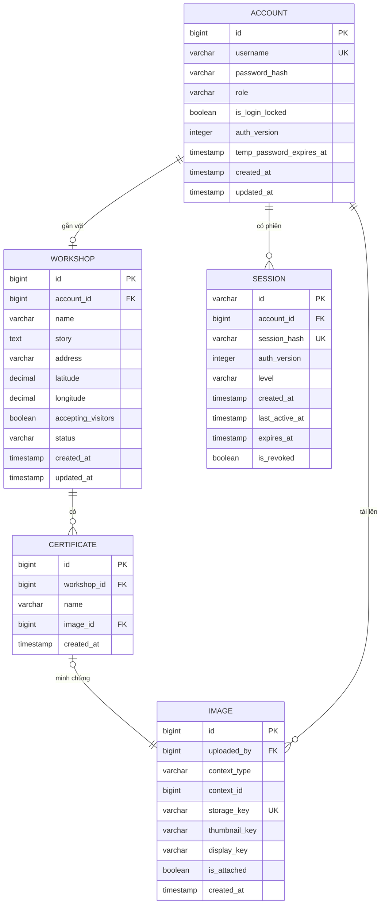
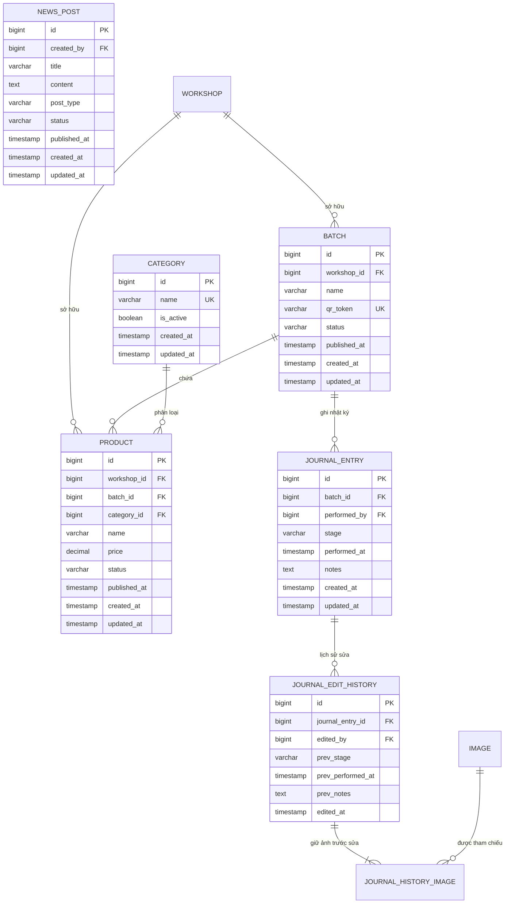
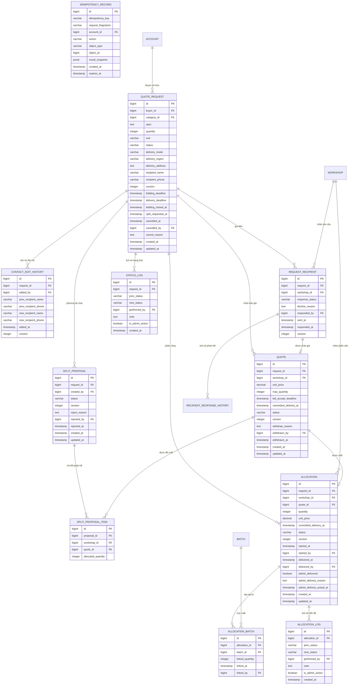
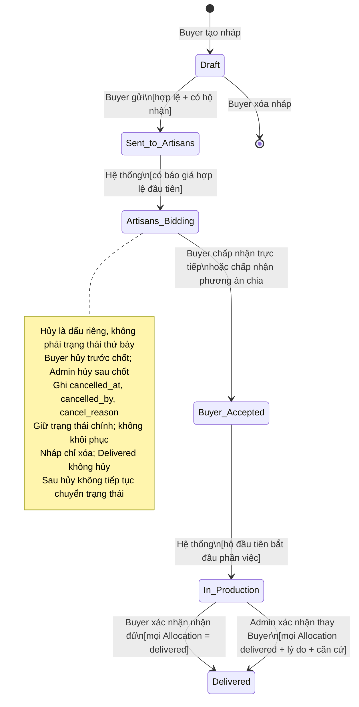
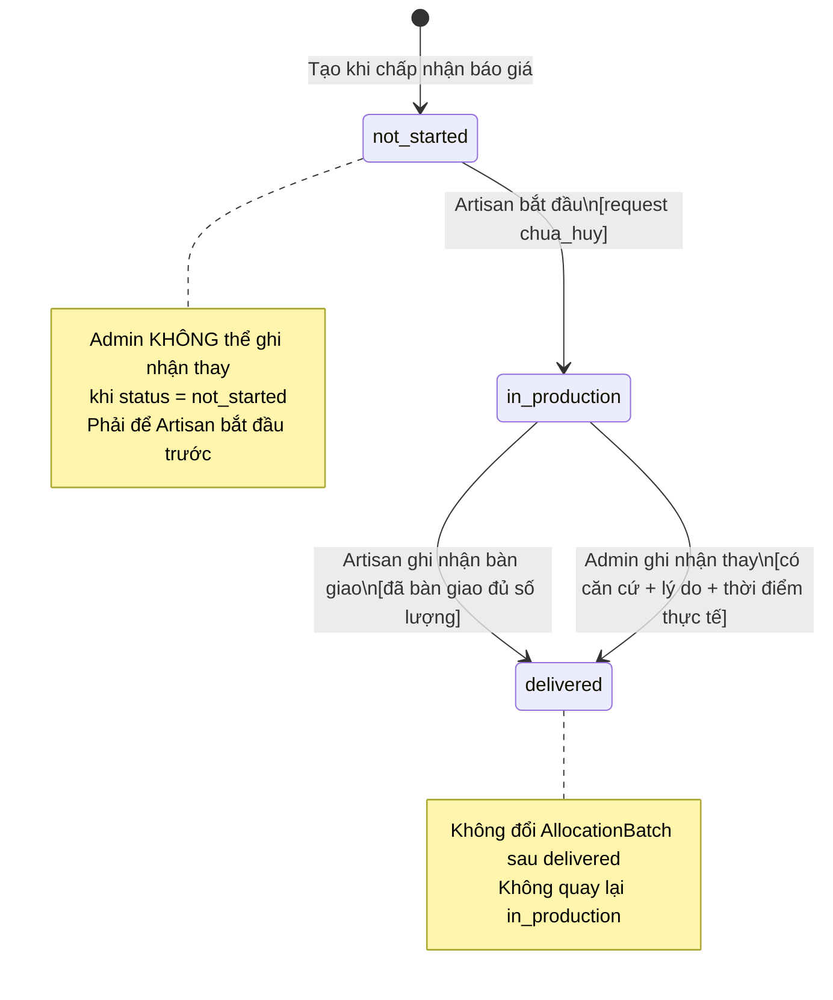
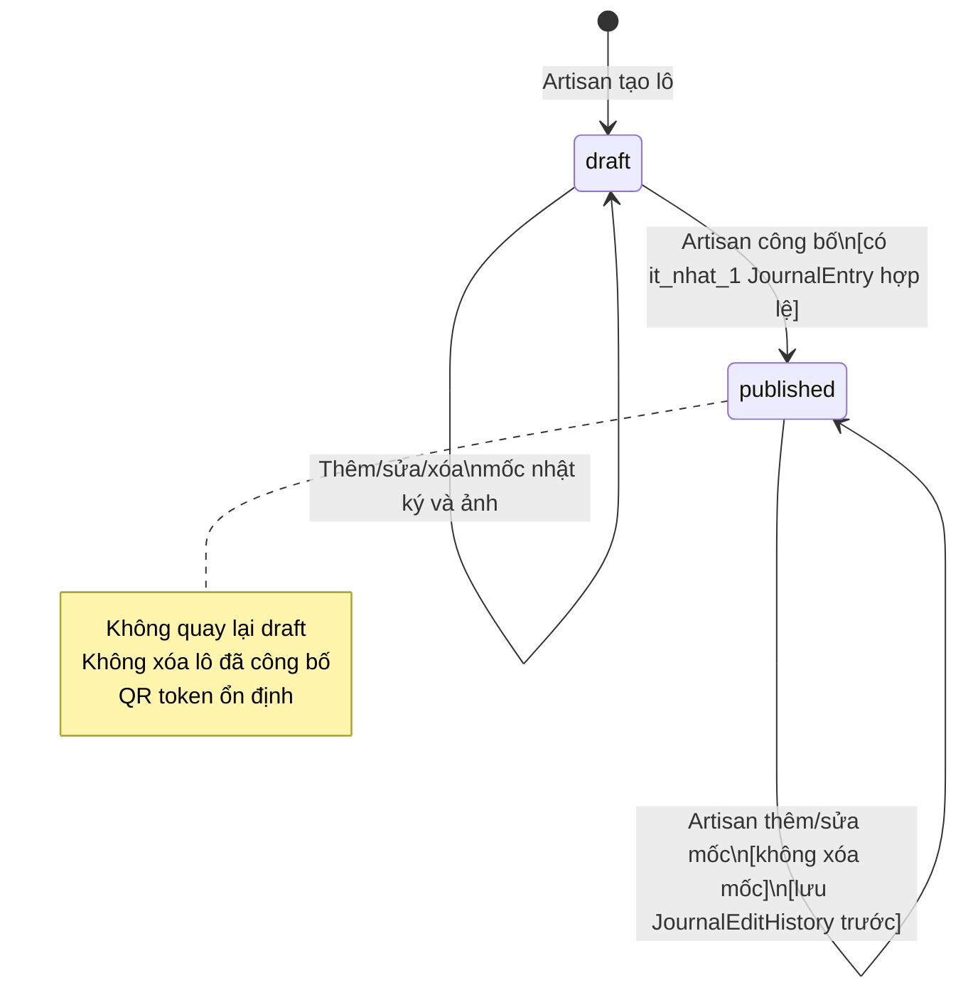
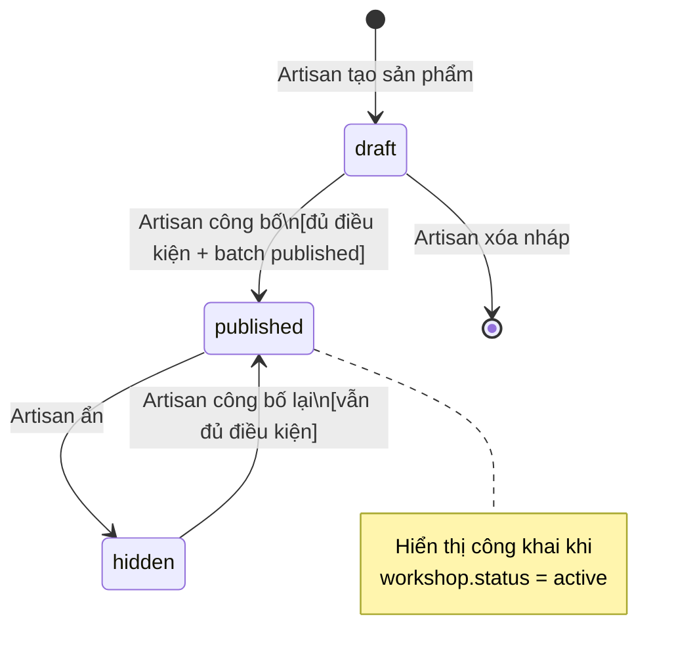
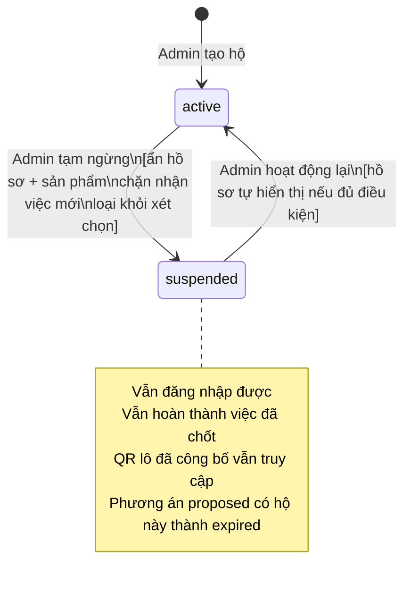
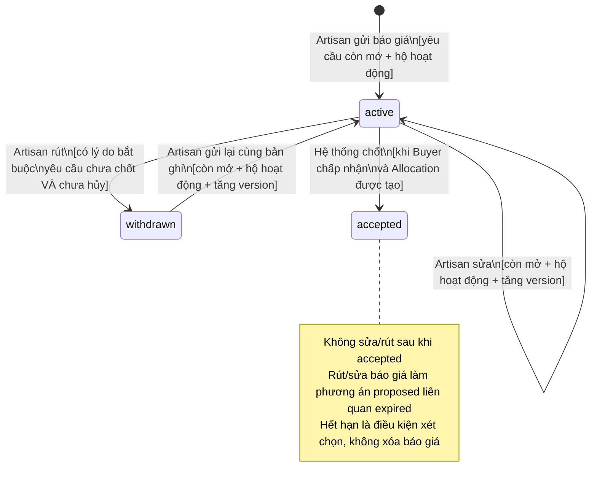
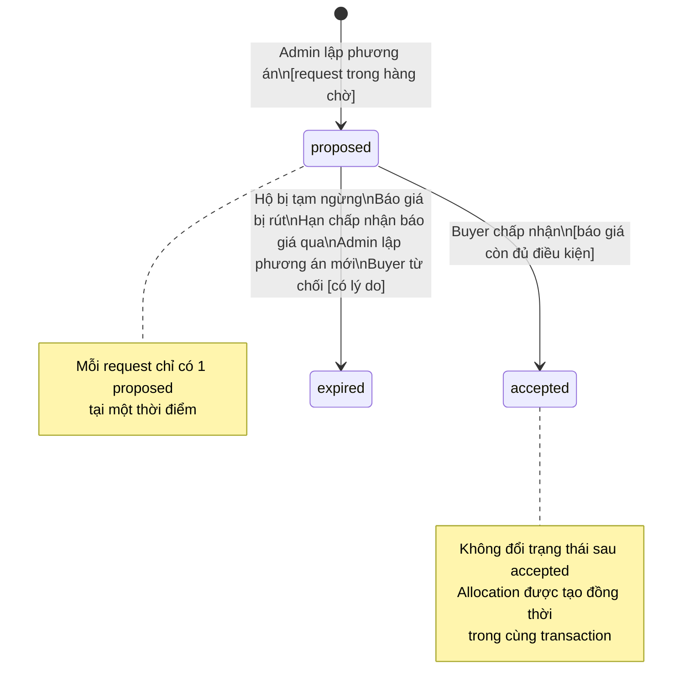

# Thiết kế dữ liệu và trạng thái — vCraft

Căn cứ: [phạm vi dự án](../01-project-brief/project-scope.md), [quy tắc nghiệp vụ](business-rules.md), [use cases](use-cases.md) và [bảo mật & phân quyền](security-and-access-control.md).

Tài liệu này xác định thực thể, thuộc tính, quan hệ, ràng buộc, trạng thái và điều kiện chuyển trạng thái cho toàn bộ hệ thống vCraft MVP.

---

## 1. ERD theo nhóm chức năng

Do số lượng thực thể lớn, ERD được chia thành 3 nhóm để dễ đọc.

### 1.1. Nhóm Xác thực & Hộ sản xuất

### 1.2. Nhóm Danh mục & Trưng bày

### 1.3. Nhóm Yêu cầu & Điều phối đơn hàng

---

## 2. Từ điển dữ liệu

### 2.1. Account — Tài khoản người dùng

| Trường | Kiểu | Null | Ràng buộc / Mô tả |
|--------|------|------|-------------------|
| `id` | bigint | No | PK, auto-increment |
| `username` | varchar(32) | No | Unique sau khi lowercase + trim. 4–32 ký tự ASCII: chữ, số, `.`, `_`. Không tự đổi |
| `password_hash` | varchar(255) | No | Argon2id `m=19MiB,t=2,p=1`; format lưu thông tin thuật toán/tham số. Không lưu bản rõ |
| `display_name` | varchar(100) | Yes | Tên hiển thị; Buyer bắt buộc; Artisan/Admin không dùng trường này |
| `phone` | varchar(20) | Yes | Số điện thoại liên hệ Buyer; chưa xác minh OTP |
| `role` | varchar(10) | No | Enum: `buyer`, `artisan`, `admin`. Server tự gán, không tin client |
| `auth_version` | integer | No | Default 1, > 0; tăng khi đổi/đặt lại mật khẩu, khóa bảo mật hoặc thu hồi toàn bộ phiên |
| `is_login_locked` | boolean | No | Default false. Khóa bảo mật do người vận hành — khác tạm ngừng hộ |
| `temp_password_expires_at` | timestamp | Yes | Hết hạn mật khẩu tạm (24h); null khi đã đổi sang mật khẩu thường |
| `created_at` | timestamp | No | UTC |
| `updated_at` | timestamp | No | UTC |

> **Ràng buộc DB:** `UNIQUE (username)`. `role` chỉ nhận 3 giá trị. Buyer/Admin không có Workshop; Artisan phải có đúng 1 Workshop liên kết. Tạo Account Artisan và Workshop trong cùng giao dịch; kiểm tra vai trò phía máy chủ, không có API đổi vai trò/chủ hộ. Khóa Account khi thay đổi bảo mật; lưu băm mới (nếu có), tăng `auth_version`, thu hồi phiên và SecurityAuditLog trong cùng giao dịch.

---

### 2.2. Workshop — Hộ / Xưởng sản xuất

| Trường | Kiểu | Null | Ràng buộc / Mô tả |
|--------|------|------|-------------------|
| `id` | bigint | No | PK |
| `account_id` | bigint | No | FK → Account (Artisan). Unique — 1 hộ 1 tài khoản |
| `name` | varchar(200) | No | Tên xưởng hiển thị công khai |
| `story` | text | Yes | Câu chuyện làm nghề |
| `address` | varchar(500) | Yes | Địa chỉ xưởng |
| `latitude` | decimal(9,6) | Yes | −90 đến 90; null nếu chưa nhập |
| `longitude` | decimal(9,6) | Yes | −180 đến 180 |
| `accepting_visitors` | boolean | No | Default false; Artisan bật/tắt |
| `status` | varchar(15) | No | Enum: `active`, `suspended`. Default `active` khi tạo |
| `created_at` | timestamp | No | UTC |
| `updated_at` | timestamp | No | UTC |

> **Ràng buộc:** `UNIQUE (account_id)`. Hồ sơ công khai khi `status = active` AND có đủ `name`, `address`, `story`, ≥1 ảnh xưởng. Hồ sơ đủ điều kiện công khai không được sửa xóa trường bắt buộc. Tọa độ phải trong khoảng hợp lệ nếu nhập.

---

### 2.3. Certificate — Chứng nhận chất lượng

| Trường | Kiểu | Null | Ràng buộc / Mô tả |
|--------|------|------|-------------------|
| `id` | bigint | No | PK |
| `workshop_id` | bigint | No | FK → Workshop |
| `name` | varchar(200) | No | Tên chứng nhận |
| `image_id` | bigint | No | FK → Image — ảnh minh chứng bắt buộc |
| `created_at` | timestamp | No | UTC |

> Không tự gắn nhãn chứng nhận khi thiếu chứng cứ. Không phải xác nhận chất lượng của Admin.

---

### 2.4. Category — Phân loại sản phẩm

| Trường | Kiểu | Null | Ràng buộc / Mô tả |
|--------|------|------|-------------------|
| `id` | bigint | No | PK |
| `name` | varchar(100) | No | Unique. VD: "Ấm, chén và cốc" |
| `is_active` | boolean | No | Default true. Không xóa phân loại đang được sử dụng |
| `created_at` | timestamp | No | UTC |
| `updated_at` | timestamp | No | UTC |

> **5 phân loại khởi tạo:** Ấm/chén/cốc; Bát/đĩa/khay; Bình/lọ/trang trí; Đồ thờ; Chậu gốm.

---

### 2.5. Product — Sản phẩm

| Trường | Kiểu | Null | Ràng buộc / Mô tả |
|--------|------|------|-------------------|
| `id` | bigint | No | PK |
| `workshop_id` | bigint | No | FK → Workshop |
| `batch_id` | bigint | No | FK → Batch cùng workshop |
| `category_id` | bigint | No | FK → Category |
| `name` | varchar(300) | No | Tên sản phẩm |
| `price` | numeric(15,0) | No | VND, > 0 |
| `description` | text | Yes | Mô tả chi tiết |
| `status` | varchar(10) | No | Enum: `draft`, `published`, `hidden` |
| `published_at` | timestamp | Yes | Thời điểm công bố lần đầu |
| `created_at` | timestamp | No | UTC |
| `updated_at` | timestamp | No | UTC |

> **Điều kiện công bố:** có `name`, `category_id`, `price > 0`, ≥1 ảnh, `batch.status = published`. Không chuyển sản phẩm sang lô khác khi lô hiện tại đã công bố.

---

### 2.6. Batch — Lô sản xuất

| Trường | Kiểu | Null | Ràng buộc / Mô tả |
|--------|------|------|-------------------|
| `id` | bigint | No | PK |
| `workshop_id` | bigint | No | FK → Workshop |
| `name` | varchar(200) | No | Tên lô |
| `qr_token` | varchar(64) | No | Unique, random khó đoán; dùng trong URL QR công khai |
| `status` | varchar(10) | No | Enum: `draft`, `published`. Không quay lại draft |
| `published_at` | timestamp | Yes | UTC |
| `created_at` | timestamp | No | UTC |
| `updated_at` | timestamp | No | UTC |

> **Điều kiện công bố:** ≥1 JournalEntry hợp lệ. Không xóa lô đã công bố hoặc lô đã dùng trong Allocation.

---

### 2.7. JournalEntry — Mốc nhật ký sản xuất

| Trường | Kiểu | Null | Ràng buộc / Mô tả |
|--------|------|------|-------------------|
| `id` | bigint | No | PK |
| `batch_id` | bigint | No | FK → Batch |
| `performed_by` | bigint | No | FK → Account (Artisan của hộ) |
| `stage` | varchar(200) | No | Công đoạn thực tế; VD: "Tạo hình", "Nung" |
| `performed_at` | timestamp | No | Thời điểm thực hiện công đoạn (do Artisan nhập) |
| `notes` | text | Yes | Ghi chú bổ sung |
| `created_at` | timestamp | No | UTC |
| `updated_at` | timestamp | No | UTC |

> **Ràng buộc:** ≥1 ảnh đính kèm qua Image. Lô nháp: thêm/sửa/xóa. Lô đã công bố: thêm/sửa, **không xóa**. Sửa lô đã công bố phải tạo JournalEditHistory trước khi cập nhật.

---

### 2.8. JournalEditHistory — Lịch sử sửa nhật ký

| Trường | Kiểu | Null | Ràng buộc / Mô tả |
|--------|------|------|-------------------|
| `id` | bigint | No | PK |
| `journal_entry_id` | bigint | No | FK → JournalEntry |
| `edited_by` | bigint | No | FK → Account |
| `prev_stage` | varchar(200) | No | Nội dung công đoạn trước khi sửa |
| `prev_performed_at` | timestamp | No | Thời điểm thực hiện trước khi sửa |
| `prev_notes` | text | Yes | Ghi chú trước khi sửa |
| `edited_at` | timestamp | No | Thời điểm hệ thống ghi nhận sửa |

> **Không có API xóa** JournalEditHistory. Ảnh tham chiếu qua `JournalHistoryImage` không được dọn dù không còn gắn trực tiếp (BR-08).

---

### 2.9. NewsPost — Tin tức cộng đồng

| Trường | Kiểu | Null | Ràng buộc / Mô tả |
|--------|------|------|-------------------|
| `id` | bigint | No | PK |
| `created_by` | bigint | No | FK → Account (Admin) |
| `title` | varchar(300) | No | Tiêu đề |
| `content` | text | No | Nội dung |
| `post_type` | varchar(30) | No | Enum: `material`, `power_schedule`, `support_policy`, `announcement` |
| `status` | varchar(10) | No | Enum: `draft`, `published` |
| `published_at` | timestamp | Yes | UTC |
| `created_at` | timestamp | No | UTC |
| `updated_at` | timestamp | No | UTC |

---

### 2.10. QuoteRequest — Yêu cầu báo giá / Đơn hàng

| Trường | Kiểu | Null | Ràng buộc / Mô tả |
|--------|------|------|-------------------|
| `id` | bigint | No | PK |
| `buyer_id` | bigint | No | FK → Account (Buyer) |
| `category_id` | bigint | Yes | FK → Category; bắt buộc khi gửi |
| `spec` | text | Yes | Quy cách gốm (kích thước, màu men, họa tiết, đóng gói…) |
| `quantity` | integer | Yes | Số lượng nguyên dương nếu nhập; bắt buộc khi gửi |
| `unit` | varchar(10) | Yes | Enum: `piece` (chiếc), `set` (bộ) |
| `unit_set_description` | text | Yes | Mô tả thành phần 1 bộ; bắt buộc khi `unit = set` |
| `status` | varchar(25) | No | Enum: `Draft Request`, `Sent to Artisans`, `Artisans Bidding`, `Buyer Accepted`, `In Production`, `Delivered` |
| `delivery_mode` | varchar(20) | Yes | Enum: `at_workshop`, `at_buyer_address` |
| `delivery_region` | varchar(200) | Yes | Tỉnh/thành phố + xã/phường (khái quát); bắt buộc khi `delivery_mode = at_buyer_address` |
| `delivery_address` | text | Yes | Địa chỉ giao chi tiết; bắt buộc khi `delivery_mode = at_buyer_address` |
| `recipient_name` | varchar(200) | Yes | Tên người nhận; bắt buộc khi gửi |
| `recipient_phone` | varchar(20) | Yes | SĐT người nhận; bắt buộc khi gửi |
| `bidding_deadline` | timestamp | Yes | Hạn nhận báo giá; lưu UTC, hiển thị UTC+7; bắt buộc khi gửi |
| `delivery_deadline` | timestamp | Yes | Hạn giao hàng; bắt buộc khi gửi |
| `bidding_closed_at` | timestamp | Yes | Thời điểm đóng thực tế (đóng sớm hoặc = bidding_deadline) |
| `split_requested_at` | timestamp | Yes | Thời điểm Buyer nhờ Admin chia đơn |
| `version` | integer | No | Default 1; tăng khi sửa nháp, gửi, đóng nhận, nhờ chia, chốt, đổi trạng thái, hủy hoặc sửa liên hệ |
| `cancelled_at` | timestamp | Yes | UTC |
| `cancelled_by` | bigint | Yes | FK → Account |
| `cancel_reason` | text | Yes | Bắt buộc khi Admin hủy |
| `created_at` | timestamp | No | UTC |
| `updated_at` | timestamp | No | UTC |

> **Bất biến sau khi gửi:** `category_id`, `spec`, `quantity`, `unit`, `unit_set_description`, `delivery_mode`, `delivery_region`, `delivery_address`, `bidding_deadline`, `delivery_deadline`. Chỉ `recipient_name`, `recipient_phone` được sửa khi chưa hủy/Delivered, có lịch sử (BR-11).

> **Nháp và gửi:** Nháp được thiếu dữ liệu; không dùng giá trị giả để thay null. CHECK có điều kiện theo status bảo đảm các trường bắt buộc khác null, chuỗi không rỗng khi đã gửi; `unit = set` cần mô tả bộ, giao tại địa chỉ Buyer cần khu vực và địa chỉ chi tiết. Khi gửi, khóa yêu cầu, kiểm tra phiên bản, phân loại hoạt động, `now < bidding_deadline` và `delivery_deadline > bidding_deadline + 24h`; chụp danh sách hộ phù hợp trong cùng giao dịch. Không có hộ phù hợp thì giữ nháp. Nháp chỉ xóa, không hủy.

> **Quyền đọc:** Tên/SĐT/địa chỉ chi tiết và lịch sử liên hệ chỉ trả cho Buyer sở hữu, Admin và hộ có Allocation của yêu cầu theo SEC-06; danh sách nhận không cấp quyền liên hệ. Hộ chưa được chốt chỉ nhận dữ liệu quy cách, số lượng, thời hạn, hình thức và khu vực khái quát. Nhãn “Không còn báo giá hợp lệ” được tính khi đọc cho Buyer/Admin, không thêm trạng thái hoặc lùi trạng thái.

---

### 2.11. ContactEditHistory — Lịch sử sửa thông tin người nhận

| Trường | Kiểu | Null | Ràng buộc / Mô tả |
|--------|------|------|-------------------|
| `id` | bigint | No | PK |
| `request_id` | bigint | No | FK → QuoteRequest |
| `edited_by` | bigint | No | FK → Account (Buyer sở hữu) |
| `prev_recipient_name` | varchar(200) | No | Tên cũ |
| `prev_recipient_phone` | varchar(20) | No | SĐT cũ |
| `new_recipient_name` | varchar(200) | No | Tên mới |
| `new_recipient_phone` | varchar(20) | No | SĐT mới |
| `edited_at` | timestamp | No | UTC |
| `version` | integer | No | Phiên bản QuoteRequest tại thời điểm sửa |

---

### 2.12. RequestRecipient — Hộ nhận yêu cầu

| Trường | Kiểu | Null | Ràng buộc / Mô tả |
|--------|------|------|-------------------|
| `id` | bigint | No | PK |
| `request_id` | bigint | No | FK → QuoteRequest |
| `workshop_id` | bigint | No | FK → Workshop |
| `response_status` | varchar(15) | No | Enum: `pending`, `declined`, `quoted`, `withdrawn` |
| `decline_reason` | text | Yes | Lý do không tham gia (tùy chọn) |
| `responded_by` | bigint | Yes | FK → Account (Artisan của hộ) |
| `responded_at` | timestamp | Yes | UTC |
| `sent_at` | timestamp | No | Thời điểm hệ thống gửi yêu cầu đến hộ |
| `version` | integer | No | Default 1; tăng khi phản hồi thay đổi |

> **Unique:** `(request_id, workshop_id)`. Điều kiện nhận yêu cầu: hộ đang hoạt động và có ≥1 sản phẩm đã công bố đúng phân loại. Không tự thêm/xóa sau khi đã gửi. Mỗi thay đổi phản hồi ghi RecipientResponseHistory cùng giao dịch; các trường phản hồi ở đây chỉ là giá trị hiện tại. Bỏ qua không tạo phản hồi hay dấu đã đọc. Chỉ được từ chối khi chưa từng có Quote và yêu cầu còn mở; từ chối rồi gửi báo giá được phép nếu vẫn đủ điều kiện.

---

### 2.13. Quote — Báo giá

| Trường | Kiểu | Null | Ràng buộc / Mô tả |
|--------|------|------|-------------------|
| `id` | bigint | No | PK |
| `request_id` | bigint | No | FK → QuoteRequest |
| `workshop_id` | bigint | No | FK → Workshop |
| `unit_price` | numeric(15,0) | No | VND, > 0; chỉ tiền hàng, không bao gồm vận chuyển |
| `max_quantity` | integer | No | ≤ `request.quantity`, nguyên dương |
| `bid_accept_deadline` | timestamp | No | Phải ≥ `request.bidding_deadline + 24h` AND < `committed_delivery_at` |
| `committed_delivery_at` | timestamp | No | ≤ `request.delivery_deadline` |
| `status` | varchar(10) | No | Enum: `active`, `withdrawn`, `accepted` |
| `version` | integer | No | Default 1; tăng mỗi lần sửa, rút, gửi lại hoặc chốt |
| `withdraw_reason` | text | Yes | Bắt buộc khi rút |
| `withdrawn_by` | bigint | Yes | FK → Account (Artisan) |
| `withdrawn_at` | timestamp | Yes | UTC |
| `created_at` | timestamp | No | UTC |
| `updated_at` | timestamp | No | UTC |

> **Unique:** `(request_id, workshop_id)`. FK ghép `(request_id, workshop_id)` → RequestRecipient để chỉ hộ đã nhận được chào giá. `UNIQUE(id, request_id, workshop_id)` phục vụ FK ghép của phương án/phần việc. Gửi lại dùng chính bản ghi Quote hiện có; trước khi thay đổi phải ghi lịch sử (mục 2.23). **Điều kiện đủ để xét chọn:** `status = active` AND `workshop.status = active` AND `now() < bid_accept_deadline` AND `committed_delivery_at ≤ delivery_deadline`; yêu cầu chưa hủy/chốt. Khi gửi/sửa/gửi lại còn phải kiểm tra yêu cầu mở nhận và `now < bid_accept_deadline`, số lượng/đơn giá hợp lệ.

---

### 2.14. SplitProposal — Phương án chia đơn

| Trường | Kiểu | Null | Ràng buộc / Mô tả |
|--------|------|------|-------------------|
| `id` | bigint | No | PK |
| `request_id` | bigint | No | FK → QuoteRequest |
| `created_by` | bigint | No | FK → Account (Admin) |
| `status` | varchar(10) | No | Enum: `proposed`, `accepted`, `expired` |
| `version` | integer | No | Default 1 |
| `reject_reason` | text | Yes | Lý do từ chối của Buyer; bắt buộc khi Buyer từ chối |
| `rejected_by` | bigint | Yes | FK → Account (Buyer) |
| `rejected_at` | timestamp | Yes | UTC |
| `created_at` | timestamp | No | UTC |
| `updated_at` | timestamp | No | UTC |

> **Ràng buộc:** Mỗi request chỉ có 1 phương án `proposed` tại một thời điểm. Dùng unique index có điều kiện trên `request_id WHERE status = proposed`. Không đổi trạng thái/nội dung phương án đã `accepted`. Mỗi lần lập lại tạo bản ghi mới, chuyển bản cũ sang `expired` và giữ lịch sử trong cùng giao dịch; không tái sử dụng bản ghi cũ. `UNIQUE(id, request_id)` phục vụ FK ghép.

---

### 2.15. SplitProposalItem — Chi tiết phân bổ trong phương án

| Trường | Kiểu | Null | Ràng buộc / Mô tả |
|--------|------|------|-------------------|
| `id` | bigint | No | PK |
| `request_id` | bigint | No | FK ghép cùng proposal_id/quote_id, bảo đảm cùng yêu cầu |
| `quote_version` | integer | No | Phiên bản báo giá tại lúc lập; kiểm tra lại khi chấp nhận |
| `proposal_id` | bigint | No | FK → SplitProposal |
| `workshop_id` | bigint | No | FK → Workshop |
| `quote_id` | bigint | No | FK → Quote |
| `allocated_quantity` | integer | No | Nguyên dương; ≤ `quote.max_quantity` |

> **Ràng buộc:** ≥2 item/phương án. Unique `(proposal_id, workshop_id)`. `SUM(allocated_quantity) = request.quantity`. FK `(proposal_id, request_id)` → SplitProposal `(id, request_id)`; FK `(quote_id, request_id, workshop_id)` → Quote `(id, request_id, workshop_id)`.

---

### 2.16. Allocation — Phần việc của từng hộ

| Trường | Kiểu | Null | Ràng buộc / Mô tả |
|--------|------|------|-------------------|
| `id` | bigint | No | PK |
| `request_id` | bigint | No | FK → QuoteRequest |
| `workshop_id` | bigint | No | FK → Workshop |
| `quote_id` | bigint | No | FK → Quote (nguồn gốc báo giá) |
| `quantity` | integer | No | Chốt cố định khi tạo |
| `unit_price` | numeric(15,0) | No | Chốt cố định khi tạo |
| `committed_delivery_at` | timestamp | No | Chốt cố định khi tạo |
| `status` | varchar(20) | No | Enum: `not_started`, `in_production`, `delivered` |
| `version` | integer | No | Default 1; tăng khi đổi trạng thái hoặc liên kết lô |
| `started_at` | timestamp | Yes | UTC |
| `started_by` | bigint | Yes | FK → Account (Artisan) |
| `delivered_at` | timestamp | Yes | UTC |
| `delivered_by` | bigint | Yes | FK → Account |
| `delivery_note` | text | Yes | Ghi chú bàn giao |
| `admin_delivered` | boolean | No | Default false; true khi Admin ghi nhận thay |
| `admin_delivery_evidence` | text | Yes | Căn cứ đã xác minh; bắt buộc khi Admin ghi nhận thay |
| `admin_delivery_reason` | text | Yes | Bắt buộc khi `admin_delivered = true` |
| `admin_delivery_actual_at` | timestamp | Yes | Thời điểm bàn giao thực tế do Admin xác nhận (không ở tương lai) |
| `created_at` | timestamp | No | UTC |
| `updated_at` | timestamp | No | UTC |

> **Bất biến sau tạo:** `quantity`, `unit_price`, `committed_delivery_at`, `workshop_id`, `request_id`, `quote_id`. `UNIQUE(request_id, workshop_id)` và `UNIQUE(quote_id)`; FK `(quote_id, request_id, workshop_id)` → Quote `(id, request_id, workshop_id)`. Admin chỉ ghi nhận thay khi `status = in_production`.

---

### 2.17. AllocationBatch — Liên kết phần việc ↔ lô truy xuất

| Trường | Kiểu | Null | Ràng buộc / Mô tả |
|--------|------|------|-------------------|
| `id` | bigint | No | PK |
| `allocation_id` | bigint | No | FK → Allocation |
| `batch_id` | bigint | No | FK → Batch (cùng workshop) |
| `linked_quantity` | integer | No | Nguyên dương; đóng góp vào tổng liên kết |
| `linked_at` | timestamp | No | UTC |
| `linked_by` | bigint | No | FK → Account (Artisan) |

> **Ràng buộc:** `SUM(linked_quantity) ≤ allocation.quantity`. Batch phải cùng Workshop. Không đổi sau `allocation.status = delivered`. Unique `(allocation_id, batch_id)`. **Thiếu liên kết không chặn** ghi nhận bàn giao — chỉ hiển thị cảnh báo.

---

### 2.18. AllocationLog — Lịch sử trạng thái phần việc

| Trường | Kiểu | Null | Ràng buộc / Mô tả |
|--------|------|------|-------------------|
| `id` | bigint | No | PK |
| `allocation_id` | bigint | No | FK → Allocation |
| `event_type` | varchar(40) | No | Loại sự kiện do server gán; xem mục 4.2 |
| `evidence` | text | Yes | Căn cứ bắt buộc khi Admin ghi nhận/xác nhận thay |
| `prev_status` | varchar(20) | Yes | Null khi tạo mới |
| `new_status` | varchar(20) | No | Trạng thái mới |
| `performed_by` | bigint | No | FK → Account |
| `note` | text | Yes | Lý do/căn cứ; bắt buộc khi Admin ghi nhận thay |
| `is_admin_action` | boolean | No | Default false |
| `created_at` | timestamp | No | UTC |

---

### 2.19. StatusLog — Lịch sử trạng thái yêu cầu

| Trường | Kiểu | Null | Ràng buộc / Mô tả |
|--------|------|------|-------------------|
| `id` | bigint | No | PK |
| `request_id` | bigint | No | FK → QuoteRequest |
| `event_type` | varchar(40) | No | Loại sự kiện do server gán; xem mục 4.2 |
| `evidence` | text | Yes | Căn cứ bắt buộc khi Admin ghi nhận/xác nhận thay |
| `prev_status` | varchar(25) | Yes | Null khi tạo draft |
| `new_status` | varchar(25) | No | Trạng thái mới |
| `performed_by` | bigint | Yes | FK → Account; null khi hệ thống tự chuyển |
| `note` | text | Yes | Lý do hủy, căn cứ xác nhận thay… |
| `is_admin_action` | boolean | No | Default false |
| `created_at` | timestamp | No | UTC |

> **Bắt buộc** ghi trong cùng transaction với mọi thay đổi trạng thái. Sự kiện hủy giữ `prev_status = new_status`, phân biệt bằng `event_type = cancelled`. Admin xác nhận thay dùng `received_by_admin`, lưu người thực hiện thật, lý do ở note và căn cứ ở evidence; Buyer được xem nhãn “Admin thực hiện thay” cùng thông tin này. Nếu thất bại → rollback toàn bộ (BR-26, SEC-13).

---

### 2.20. Image — Ảnh đã xử lý

| Trường | Kiểu | Null | Ràng buộc / Mô tả |
|--------|------|------|-------------------|
| `id` | bigint | No | PK |
| `uploaded_by` | bigint | No | FK → Account |
| `context_type` | varchar(30) | No | Enum: `workshop_profile`, `certificate`, `product`, `journal_entry` |
| `context_id` | bigint | Yes | ID chủ sở hữu; có thể null khi chờ gắn đối tượng mới; cố định từ lần gắn đầu |
| `storage_key` | varchar(255) | Yes | Unique; key ngẫu nhiên trong kho lưu trữ — không dùng tên gốc |
| `thumbnail_key` | varchar(255) | No | Key ảnh thumbnail ≤320px cạnh dài |
| `display_key` | varchar(255) | No | Key ảnh hiển thị ≤1600px cạnh dài |
| `original_size_bytes` | integer | No | Dung lượng bản gốc còn giữ; 0 nếu không giữ |
| `thumbnail_size_bytes` | bigint | No | Byte thực của thumbnail |
| `display_size_bytes` | bigint | No | Byte thực của bản hiển thị |
| `quota_id` | bigint | No | FK → StorageQuota; chủ quota cố định theo ngữ cảnh hộ/tài khoản |
| `reservation_id` | bigint | No | Unique FK → UploadReservation |
| `width` | integer | No | Chiều rộng ảnh gốc (px) |
| `height` | integer | No | Chiều cao ảnh gốc (px) |
| `is_attached` | boolean | No | Default false; đang được nội dung hiện hành tham chiếu; bỏ gắn không xóa chủ sở hữu |
| `created_at` | timestamp | No | UTC |

> Dọn ảnh không còn tham chiếu hiện hành/lịch sử sau 24 giờ không được tham chiếu (lưu `unreferenced_at`, timestamp nullable; null khi có tham chiếu). Không dọn ảnh được tham chiếu trong JournalHistoryImage. Một image_id chỉ thuộc một đối tượng; không chuyển chủ hoặc dùng chung cho đối tượng khác. Lịch sử chỉ tham chiếu ảnh cùng JournalEntry, không đổi context thành lịch sử. Quyền đọc phụ thuộc ngữ cảnh hiện hành/lịch sử của URL; ảnh hiện hành công khai không làm lịch sử công khai. Chỉ tạo Image khi xử lý thành công; khóa quota và đối tượng khi gắn/gỡ ảnh, không để dọn ảnh đua với tạo tham chiếu. Kho lưu trữ không có quyền truy cập công khai trực tiếp — mọi truy cập qua cổng kiểm tra quyền phía server (SEC-10).

---

### 2.21. Session — Phiên đăng nhập

| Trường | Kiểu | Null | Ràng buộc / Mô tả |
|--------|------|------|-------------------|
| `id` | varchar(64) | No | PK nội bộ |
| `account_id` | bigint | No | FK → Account |
| `session_hash` | varchar(255) | No | Unique; hash của session token thực tế |
| `auth_version` | integer | No | Bản chụp Account.auth_version khi tạo phiên |
| `level` | varchar(15) | No | Enum: `normal`, `temp_password` |
| `created_at` | timestamp | No | UTC |
| `last_active_at` | timestamp | No | Cập nhật mỗi request |
| `expires_at` | timestamp | No | `normal`: 12h từ tạo; `temp_password`: 15 phút |
| `is_revoked` | boolean | No | Default false; true sau đăng xuất/đổi mật khẩu |

> Session token thực tế (≥256 bit entropy) chỉ tồn tại trong cookie `__Host-vcraft-session; Secure; HttpOnly; SameSite=Lax`. Chỉ lưu hash. Không lưu token trong URL, localStorage, sessionStorage. Xác minh mật khẩu ngoài khóa; trước tạo phiên khóa Account rồi kiểm tra lại auth_version, trạng thái khóa và hạn mật khẩu tạm. Request riêng tư chỉ chấp nhận phiên có auth_version khớp Account. Kho phiên khách trước đăng nhập tách riêng, cookie riêng, TTL 15 phút; không tạo Session với account_id null. Nếu dùng cache phiên, auth_version trong DB vẫn là căn cứ thu hồi, không phụ thuộc thành công của xóa cache.

---

### 2.22. IdempotencyRecord — Ghi nhận thao tác đã thực hiện (BR-27)

| Trường | Kiểu | Null | Ràng buộc / Mô tả |
|--------|------|------|-------------------|
| `id` | bigint | No | PK |
| `idempotency_key` | varchar(128) | No | Do client tạo; duy nhất trong phạm vi thao tác bên dưới |
| `request_fingerprint` | varchar(64) | No | SHA-256 của đầu vào chuẩn hóa gồm payload và phiên bản kỳ vọng; không lưu mật khẩu/token |
| `account_id` | bigint | No | FK → Account |
| `action` | varchar(50) | No | VD: `accept_quote`, `deliver_allocation` |
| `object_type` | varchar(30) | No | VD: `quote_request`, `allocation` |
| `object_id` | bigint | No | ID đối tượng |
| `result_snapshot` | jsonb | No | Kết quả đã lưu; trả lại khi gửi lặp đúng nội dung |
| `created_at` | timestamp | No | UTC |
| `expires_at` | timestamp | No | TTL; dọn sau khi hết hạn |

> **Unique:** `(account_id, action, object_type, object_id, idempotency_key)`. Cùng khóa khác fingerprint trả 409, không thực thi lại. Bản ghi kết quả và thay đổi nghiệp vụ commit cùng giao dịch; yêu cầu cạnh tranh cùng khóa chờ giao dịch trước rồi đọc kết quả hoặc thử lại nếu rollback. Không commit bản ghi thành công khi nghiệp vụ thất bại. TTL khởi điểm 24 giờ, dọn nền; hết TTL vẫn kiểm tra trạng thái và ràng buộc duy nhất, không thực thi lại thao tác đã hoàn tất.

> Không trả kết quả của tài khoản khác dù biết key. Khi trả lại kết quả vẫn lọc theo quyền hiện tại.

---

## 3. Sơ đồ trạng thái

### 3.1. QuoteRequest — Yêu cầu báo giá

---

### 3.2. Allocation — Phần việc

---

### 3.3. Batch — Lô sản xuất

---

### 3.4. Product — Sản phẩm

---

### 3.5. Workshop — Hộ sản xuất

---

### 3.6. Quote — Báo giá

---

### 3.7. SplitProposal — Phương án chia đơn

---

## 4. Ràng buộc DB tổng hợp

| Ràng buộc | Mô tả |
|-----------|-------|
| `UNIQUE (account.username)` | Tên đăng nhập duy nhất sau lowercase+trim |
| `UNIQUE (workshop.account_id)` | Mỗi hộ đúng 1 tài khoản Artisan |
| `UNIQUE (batch.qr_token)` | QR token không trùng |
| `UNIQUE (session.session_hash)` | Hash phiên không trùng |
| `UNIQUE (request_recipient.request_id, workshop_id)` | Mỗi hộ xuất hiện 1 lần/yêu cầu |
| `UNIQUE (quote.request_id, workshop_id)` | Mỗi hộ tối đa 1 báo giá/yêu cầu |
| `UNIQUE (split_proposal_item.proposal_id, workshop_id)` | Mỗi hộ 1 lần trong phương án |
| `UNIQUE (allocation_batch.allocation_id, batch_id)` | Mỗi lô gắn 1 lần/phần việc |
| `CHECK quantity > 0` | Số lượng dương (Quote, Allocation, AllocationBatch) |
| `CHECK unit_price > 0` | Đơn giá dương |
| `CHECK price > 0` | Giá sản phẩm dương |
| `CHECK max_quantity <= request.quantity` | Số lượng chào không vượt yêu cầu |
| `SUM(split_proposal_item.allocated_quantity) = request.quantity` | Tổng phân bổ đúng bằng yêu cầu |
| `SUM(allocation_batch.linked_quantity) <= allocation.quantity` | Tổng liên kết không vượt phần việc |
| `CHECK latitude BETWEEN -90 AND 90` | Tọa độ hợp lệ |
| `CHECK longitude BETWEEN -180 AND 180` | Tọa độ hợp lệ |
| `CHECK allocation_batch.batch.workshop_id = allocation.workshop_id` | Lô phải cùng hộ |

---

## 5. Ghi chú thiết kế và điểm cần làm rõ khi implement

### 5.1. Quyết định thiết kế chính

- **QuoteRequest kiêm vai trò đơn hàng:** Sau khi Buyer chấp nhận, không tạo thêm thực thể `Order` riêng. QuoteRequest xuyên suốt từ nháp đến giao hàng (BR nguyên tắc 2).
- **Không soft-delete chuẩn:** Xóa thật chỉ áp dụng cho nháp (QuoteRequest draft, Product draft). Mọi trạng thái khác chuyển sang trạng thái cuối hoặc bị ẩn.
- **StatusLog và AllocationLog ghi bắt buộc trong transaction:** Nếu log thất bại thì rollback toàn bộ (SEC-13, BR-26).
- **Rate-limit counters không lưu trong DB chính:** Dùng Redis/store riêng; cập nhật nguyên tử giữa các instance (SEC-05).
- **Timestamp tất cả lưu UTC:** Hiển thị convert sang UTC+7 ở tầng API hoặc frontend.
- **Image polymorphic:** `context_type + context_id` được validate ở application layer; không dùng FK ngoại vì nhiều bảng đích.

### 5.2. Điểm cần làm rõ khi implement

| # | Điểm mở | Mức ưu tiên |
|---|---------|------------|
| 1 | `SplitProposal` hết hiệu lực tự động: trigger DB hay lazy-check khi đọc? | Cao |
| 2 | Index cho `session.session_hash`: B-tree hay hash index? (ảnh hưởng mỗi request) | Cao |
| 3 | `IdempotencyRecord` TTL: bao lâu hết hạn? Dọn bằng cron hay trigger? | Trung bình |
| 4 | `SplitProposal` lập lại: tăng `version` trên bản ghi cũ hay insert bản ghi mới? (ảnh hưởng lịch sử BR-18) | Trung bình |
| 5 | Giới hạn số phương án lưu/yêu cầu: có TTL xóa phương án `expired` cũ không? | Thấp |
| 6 | Session store: lưu trong DB chính hay Redis? Nếu DB thì cần partition theo `expires_at` | Cao |

---

*Tài liệu này quy định cấu trúc dữ liệu, chưa chứng minh đã được cài đặt. Khi chọn ORM/framework, phải ánh xạ từng thực thể, ràng buộc và trigger vào migration tương ứng. Các ngưỡng giới hạn tài nguyên theo [security-and-access-control.md](security-and-access-control.md) — SEC-14.*
