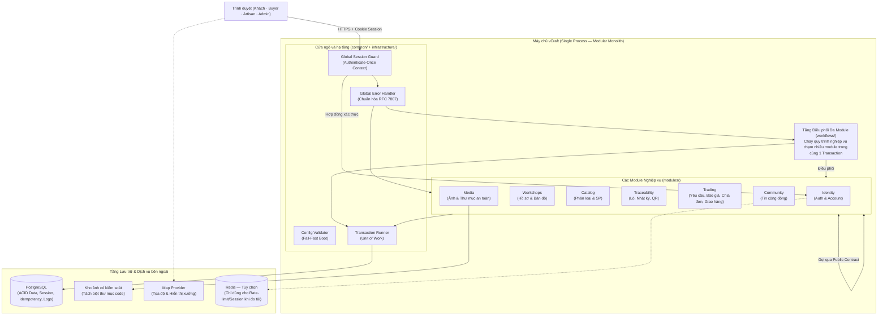
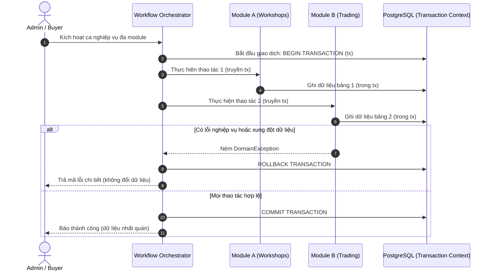
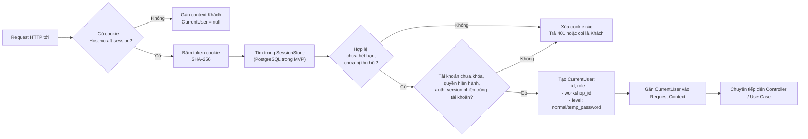
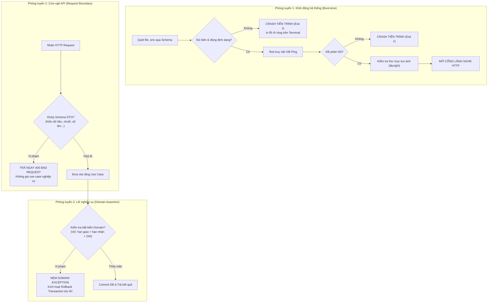
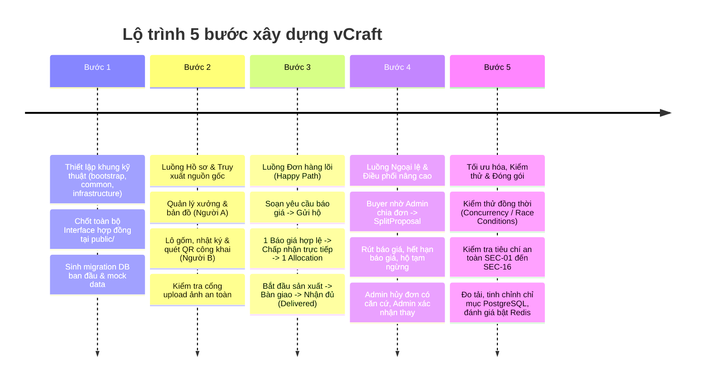

# Thiết kế kiến trúc tổng thể — vCraft

Căn cứ: [phạm vi dự án](../01-project-brief/project-scope.md), [quy tắc nghiệp vụ](../02-specifications/business-rules.md), [use cases](../02-specifications/use-cases.md), [bảo mật & phân quyền](../02-specifications/security-and-access-control.md) và [thiết kế dữ liệu](../02-specifications/data-design.md).

---

## 1. Nguyên tắc kiến trúc cốt lõi

Hệ thống vCraft được thiết kế phục vụ một làng nghề duy nhất (Bát Tràng) với nhóm phát triển gồm 3 thành viên, hướng tới mục tiêu hoạt động ổn định, bảo mật cao và sẵn sàng bảo vệ vấn đáp kỹ thuật. Kiến trúc kết hợp hài hòa 3 phong cách theo phương châm **thực dụng, tinh gọn và hướng giao dịch (transaction-first)**:

1. **Modular Monolith (Nguyên khối theo module):** Toàn bộ backend chạy trong **một tiến trình (single process)** duy nhất, sử dụng chung một cơ sở dữ liệu PostgreSQL. Các tính năng được phân chia thành các module nghiệp vụ độc lập, ranh giới rõ ràng, không phân tán thành microservices.
2. **Clean & Hexagonal Architecture "Gọn" (Ports & Adapters):** 
   - Lõi nghiệp vụ (Domain & Application) độc lập hoàn toàn với framework HTTP, thư viện ORM, kho lưu trữ file hay cache.
   - Chỉ tạo **Port** tại những ranh giới cần kiểm thử độc lập hoặc có khả năng thay thế (Repository, Storage, Hasher, Clock, Transaction Runner). Không tạo Interface dàn trải cho mọi class.
   - Thao tác truy vấn danh sách (Read Model) được phép trả DTO trực tiếp từ Adapter/SQL, không bắt buộc dựng lại toàn bộ Domain Entity phức tạp.
3. **Giao tiếp qua Hợp đồng định trước (Contract-First via Public API):**
   - Luồng ghi không sửa trực tiếp bảng hoặc truy cập domain nội bộ của module khác. Luồng đọc tổng hợp có ngoại lệ JOIN chỉ đọc, được giới hạn và kiểm soát theo mục 4.3.
   - Mỗi module công khai một thư mục `public/` chứa **Interface Service, DTO và Enums**. Các thành viên khác chỉ phụ thuộc vào hợp đồng này, cho phép viết Mock/Stub để phát triển tính năng song song mà không bị nghẽn tiến độ.
4. **Xác thực một lần ở cửa ngõ (Authenticate-Once Context):**
   - Kiểm tra phiên đăng nhập và định danh tài khoản được xử lý tập trung một lần duy nhất tại Global Session Guard ở tầng ngoài cùng.
   - Guard đọc mã phiên từ cookie `__Host-vcraft-session`, gọi hợp đồng Identity để kiểm tra phiên và tài khoản hiện hành, rồi tạo `CurrentUser` thuần TypeScript. Use case vẫn kiểm tra quyền sở hữu, quyền trên từng trường và trạng thái nghiệp vụ; các thao tác bảo mật nhạy cảm kiểm tra lại quyền trong transaction theo SEC-05.
5. **Nguyên tắc Thất bại sớm (Fail-Fast):**
   - **Lúc khởi động (Boot-time):** Validate toàn bộ biến môi trường `.env`, kiểm tra kết nối DB và quyền ghi thư mục ảnh trước khi mở cổng HTTP. Sai cấu hình thì dừng tiến trình ngay (`exit(1)`).
   - **Tại cửa ngõ Request:** DTO được validate chặt chẽ (schema, kiểu, giá trị âm/dương) ngay tại Controller; dữ liệu rác bị chặn với mã `400` trước khi chạm vào tầng nghiệp vụ.
   - **Trong lõi nghiệp vụ (Domain Invariants):** Mọi vi phạm quy tắc trạng thái hoặc số lượng đều ném lỗi Domain Exception lập tức để kích hoạt Rollback giao dịch.
6. **Ưu tiên Tính đúng đắn & ACID hơn Bộ nhớ đệm (Correctness over Caching):**
   - Toàn bộ thao tác chốt đơn, kiểm tra tổng phân bổ, tạo Allocation với điều kiện cố định, kiểm tra hộ hoạt động, ghi nhật ký trạng thái (StatusLog) và lưu dấu vết chống gửi lặp (IdempotencyRecord theo BR-27) đều diễn ra trong **cùng một Transaction PostgreSQL nguyên tử**.
   - MVP dùng PostgreSQL cho session và giới hạn xác thực. Redis là adapter mở rộng khi có nhu cầu đo được; không dùng Redis để bảo đảm chốt đơn hoặc lưu kết quả idempotency thay transaction PostgreSQL. Nếu bổ sung cache phiên, `auth_version` trong DB vẫn là căn cứ thu hồi theo SEC-05.

---

## 2. Sơ đồ kiến trúc tổng thể



---

## 3. Tổ chức cấu trúc mã nguồn

Cấu trúc triển khai dùng React + TypeScript ở frontend và NestJS + TypeScript ở backend. PostgreSQL là database chung, Prisma nằm ở adapter persistence. Domain, application, public contract và use case workflow giữ độc lập với NestJS/Prisma.

### 3.1. Cấu trúc repository

```text
vCraft/
├── frontend/
│   ├── public/                         # Tài nguyên tĩnh công khai
│   ├── src/
│   │   ├── app/
│   │   │   ├── router/
│   │   │   ├── providers/              # QueryClient, auth context, theme
│   │   │   └── layouts/                # Public, Buyer, Artisan, Admin
│   │   ├── features/
│   │   │   ├── auth/
│   │   │   ├── workshops/
│   │   │   ├── catalog/
│   │   │   ├── traceability/
│   │   │   ├── trading/
│   │   │   └── community/
│   │   ├── components/
│   │   │   ├── ui/
│   │   │   └── shared/                 # ImageUploader, Pagination...
│   │   ├── api/
│   │   │   ├── client.ts               # Cookie, CSRF, xử lý lỗi
│   │   │   └── generated/              # Kiểu/client sinh từ OpenAPI
│   │   ├── hooks/
│   │   ├── lib/
│   │   ├── assets/
│   │   ├── styles/
│   │   └── main.tsx
│   ├── tests/
│   │   ├── unit/
│   │   ├── integration/
│   │   └── support/
│   ├── package.json
│   └── vite.config.ts
├── backend/
│   ├── src/
│   │   ├── common/
│   │   │   ├── domain/                 # Thuần TypeScript
│   │   │   │   ├── errors/
│   │   │   │   └── value-objects/      # Money nếu nhiều module dùng
│   │   │   ├── application/            # Hợp đồng thuần dùng chung
│   │   │   │   ├── types/              # CurrentUser, Pagination
│   │   │   │   └── ports/              # Clock, TransactionRunner, TransactionContext
│   │   │   ├── config/                 # Đọc và kiểm tra môi trường
│   │   │   ├── http/
│   │   │   │   ├── filters/
│   │   │   │   ├── interceptors/
│   │   │   │   ├── middleware/         # Request ID, request context
│   │   │   │   ├── pipes/
│   │   │   │   └── swagger/
│   │   │   ├── security/
│   │   │   │   ├── decorators/
│   │   │   │   └── guards/             # Session, vai trò, CSRF
│   │   │   └── observability/          # Logging, che dữ liệu nhạy cảm
│   │   ├── infrastructure/
│   │   │   ├── database/
│   │   │   │   ├── prisma/             # Client và kết nối
│   │   │   │   └── transactions/       # Triển khai TransactionRunner
│   │   │   └── clock/
│   │   ├── modules/
│   │   │   ├── identity/               # Tài khoản, phiên, mật khẩu
│   │   │   ├── workshops/              # Hồ sơ, trạng thái hộ, tọa độ
│   │   │   ├── catalog/                # Phân loại, sản phẩm
│   │   │   ├── traceability/           # Lô, nhật ký, lịch sử, QR
│   │   │   ├── trading/                # Báo giá, chia đơn, phần việc, hủy
│   │   │   ├── community/
│   │   │   └── media/                  # Upload, tối ưu và quyền đọc ảnh
│   │   ├── workflows/
│   │   │   ├── register-artisan/       # Tạo Account + Workshop
│   │   │   ├── suspend-workshop/       # Tạm ngừng + vô hiệu phương án đề xuất
│   │   │   └── accept-quotation/       # Kiểm tra hộ + chốt trực tiếp/phương án
│   │   ├── bootstrap/
│   │   │   ├── app.module.ts
│   │   │   ├── security.module.ts      # Nối guard với Identity contract
│   │   │   └── workflows.module.ts
│   │   └── main.ts
│   ├── prisma/                         # Định nghĩa dữ liệu, migration, seed
│   ├── tests/
│   │   ├── unit/
│   │   │   ├── modules/
│   │   │   └── workflows/
│   │   ├── integration/
│   │   │   ├── persistence/
│   │   │   └── workflows/
│   │   ├── api/
│   │   ├── contracts/
│   │   ├── architecture/
│   │   └── support/                    # Fixtures, mocks, database test
│   ├── package.json
│   └── nest-cli.json
├── tests/
│   └── e2e/                            # Playwright xuyên frontend/backend
├── deploy/
│   ├── compose.yaml
│   └── reverse-proxy/
├── docs/
├── .gitignore
└── README.md
```

Đây là cấu trúc đích, chỉ tạo thư mục khi có code tương ứng. Ảnh upload nằm trên volume riêng có kiểm soát truy cập, không đặt trong frontend/public hoặc mã nguồn. Frontend và API cùng origin qua reverse proxy. Phiên bản thư viện và cấu hình Prisma được chốt riêng khi thiết lập môi trường.

### 3.2. Cấu trúc module backend

```text
modules/trading/
├── public/
│   ├── contracts/                     # Hợp đồng liên module, thuần TypeScript
│   └── dtos/
├── domain/
│   ├── entities/                      # QuoteRequest, Quote, Allocation, SplitProposal
│   ├── value-objects/
│   ├── policies/                      # Quy tắc chọn giá, phân bổ, chuyển trạng thái
│   └── errors/
├── application/
│   ├── use-cases/
│   │   ├── requests/
│   │   ├── quotations/
│   │   ├── allocation-plans/
│   │   └── fulfillment/
│   ├── ports/
│   │   ├── repositories/
│   │   └── queries/
│   ├── dtos/                          # Input/output thuần của use case
│   └── services/                      # Triển khai public contract
├── adapters/
│   ├── http/
│   │   ├── controllers/
│   │   ├── dtos/                      # HTTP validation và serialization
│   │   └── mappers/
│   └── persistence/
│       ├── repositories/              # Prisma/SQL, gồm ghi idempotency của Trading
│       ├── queries/                   # Read DTO, ngoại lệ JOIN tại mục 4.3
│       └── mappers/
└── trading.module.ts                   # Nest DI wiring
```

DTO đặt theo ranh giới sử dụng, không gom vào persistence. Adapter persistence chứa truy vấn và mapping giữa dữ liệu DB và domain; không trả Prisma model qua public contract. Module Media bổ sung adapters/storage và adapters/image-processing khi cần; Identity có adapters/crypto và các port SessionStore, PasswordHasher, LoginAttemptStore trong application/ports.

### 3.3. Cấu trúc feature frontend

```text
features/trading/
├── pages/
├── components/
├── api/                               # Hàm gọi API nghiệp vụ
├── hooks/                             # Query/mutation hooks
├── schemas/                           # Validation biểu mẫu
└── types/                             # Kiểu giao diện riêng
```

Các vai trò dùng routes/pages phù hợp trong cùng feature, tránh sao chép toàn bộ Trading theo vai trò. Frontend dùng hợp đồng OpenAPI, không import entity backend hoặc kiểu Prisma. Kiểm tra phía giao diện không thay thế phân quyền và validation máy chủ.

### 3.4. Quy tắc phụ thuộc và kiểm thử

- Domain chỉ dùng domain của chính module và common/domain. Application dùng domain, common/application và public contract cần thiết. Domain/application/public/workflow không import NestJS, Prisma, adapters hoặc các nhánh kỹ thuật của common.
- Module khác chỉ gọi modules/Y/public; không import nội bộ domain/application/adapters. Ngoại lệ đọc SQL ở mục 4.3 không cho phép import code nội bộ hoặc ghi bảng module khác.
- common/domain và common/application không phụ thuộc module. Guard có thể phụ thuộc hợp đồng identity/public; bootstrap/security.module.ts lắp implementation. Guard không tự truy vấn Prisma.
- *.module.ts và bootstrap là composition root, được import implementation để lắp dependency. Use case là class TypeScript thường; đăng ký bằng provider factory để không cần decorator Nest trong lõi. Token DI dùng giá trị runtime rõ ràng, không dùng interface TypeScript như token runtime.
- Port TransactionRunner/TransactionContext ở common/application/ports; implementation ở infrastructure/database/transactions. common không có nghĩa mọi tầng đều được import mọi nhánh.
- Unit test kiểm tra domain/use case bằng mock. Integration test dùng PostgreSQL thật để kiểm tra khóa, rollback và idempotency; mock không chứng minh được transaction đúng. API test kiểm tra phiên, quyền từng trường, CSRF và ảnh; contracts kiểm tra hành vi hợp đồng; architecture kiểm tra import; E2E kiểm tra các luồng demo chính.
- Repository/migration có người sở hữu theo module dù migrations tập trung tại backend/prisma. Không tạo repository dùng chung chứa mọi nghiệp vụ. Redis chưa là dependency của MVP.

---

## 4. Giao tiếp liên module và Quản trị Giao dịch (Workflows)

### 4.1. Giao tiếp qua Hợp đồng (Contract-First)

Khi Module A cần dữ liệu hoặc xác thực từ Module B:
1. Module B công khai Interface trong `modules/B/public/contracts/`.
2. Module B triển khai interface đó trong chính module của mình.
3. Module A chỉ tiêm (*inject*) Interface đó để gọi.
4. **Hỗ trợ phát triển song song:** Người phụ trách Module A có thể tạo một `MockModuleBContract` trong thư mục test để code hoàn chỉnh use case của mình ngay cả khi người phụ trách Module B chưa viết xong cơ sở dữ liệu.

*Ví dụ hợp đồng phục vụ transaction (kiểu đều thuần TypeScript):*

```typescript
// TransactionContext là handle opaque do TransactionRunner tạo;
// chỉ adapter database giải được handle thành client giao dịch.
export interface IWorkshopContract {
  lockAndAssertActive(workshopIds: readonly string[], tx: TransactionContext): Promise<void>;
  getWorkshopSummary(workshopId: string): Promise<WorkshopSummaryDto | null>;
}
```

Hàm đọc summary không được dùng thay kiểm tra hộ trong transaction chốt đơn. Tìm hộ phù hợp theo phân loại dùng query contract của Catalog (JOIN chỉ đọc theo mục 4.3); trước gửi phải kiểm tra lại điều kiện trong giao dịch. Mã ID qua JSON dùng chuỗi để tránh truyền bigint trực tiếp.

### 4.2. Điều phối giao dịch đa module (`workflows/`)

Có những ca nghiệp vụ thay đổi dữ liệu trên nhiều module và bắt buộc phải **thành công toàn bộ hoặc thất bại toàn bộ (ACID)**. Các use case này không thuộc riêng về một module nào mà được đặt tại tầng `workflows/`.

*Chiến lược thực thi:*

- Workflow hoặc use case cấp cao nhất mở transaction qua TransactionRunner; mọi public operation/repository tham gia giao dịch phải nhận `tx` bắt buộc. Không có fallback về client toàn cục, không tự mở transaction con hoặc commit trong module.
- TransactionContext là hợp đồng opaque, không chứa Prisma.TransactionClient hay API SQL trong kiểu công khai. Adapter giữ ánh xạ context sang client; context thiếu, hết hạn hoặc không thuộc transaction đang chạy phải bị từ chối.
- Các kiểm tra dữ liệu, ghi Allocation, trạng thái, lịch sử bắt buộc và IdempotencyRecord dùng cùng transaction. Lỗi nghiệp vụ hoặc lỗi hạ tầng đều rollback. Không gọi dịch vụ mạng, băm mật khẩu hay xử lý ảnh trong khi giữ khóa.
- Chốt trực tiếp và chấp nhận phương án cùng dùng quy tắc Trading: kiểm tra báo giá chưa rút, hạn chấp nhận, hộ hoạt động, phiên bản; số lượng từng phần hợp lệ và tổng bằng yêu cầu. Lưu cố định hộ, số lượng, giá, hạn giao. Không trừ tồn kho/công suất, không giữ chỗ giữa các yêu cầu và không tạo Order riêng (BR-14, BR-20, BR-24).
- Workflow chỉ điều phối; quy tắc giá, số lượng và trạng thái thuộc Trading. Cấp tài khoản + hồ sơ, tạm ngừng + vô hiệu phương án và chấp nhận đều phải dùng hợp đồng giao dịch của các module liên quan.

**Khóa và cạnh tranh cập nhật:**

- MVP dùng transaction ngắn và khóa dòng PostgreSQL. Thứ tự khóa chung cho các luồng liên quan: Workshop theo ID tăng dần → QuoteRequest theo ID tăng dần → phản hồi/báo giá/phương án/phần việc theo thứ tự loại cố định và ID. Luồng chỉ cần tập con được bỏ qua các bước không liên quan; không lấy thêm khóa ở vị trí trước khóa đã giữ.
- Chấp nhận và thay đổi trạng thái hộ cùng khóa Workshop. Rút/sửa báo giá và chấp nhận cùng khóa QuoteRequest trước báo giá. Tạm ngừng hộ khóa hộ trước, rồi khóa các yêu cầu liên quan theo ID và vô hiệu phương án còn đề xuất trong transaction; hoạt động lại không phục hồi phương án cũ.
- Nếu cần đọc trước để biết tập hộ của phương án, đọc ID/phiên bản, lấy khóa đúng thứ tự rồi đọc lại yêu cầu/phương án. Nếu tập hộ hoặc phiên bản đổi, rollback và báo xung đột; không tiếp tục trên tập khóa cũ. Kiểm tra lại thời gian sau khi chờ khóa bằng thời gian máy chủ hiện hành.
- Bắt đầu/bàn giao/gắn lô khóa QuoteRequest để phối hợp với hủy và xác nhận nhận đủ, sau đó khóa Allocation. Khi gắn lô cần kiểm tra quyền và tham chiếu lô trong cùng transaction; các khóa bổ sung phải có thứ tự thống nhất. Mỗi Allocation dùng version riêng; không yêu cầu version của yêu cầu cho thay đổi phần việc độc lập. Chỉ tăng version yêu cầu khi trạng thái chính hoặc liên hệ thay đổi. Hai hộ có thể chờ khóa ngắn nhưng không bị báo phiên bản cũ chỉ vì hộ khác cập nhật.
- Xác nhận nhận đủ khóa yêu cầu và kiểm tra toàn bộ phần việc trong transaction; hủy và hoàn tất chỉ một kết quả được commit. Giữ unique constraint cho cặp yêu cầu–hộ ở Allocation và báo giá, cùng ràng buộc tối đa một phương án đề xuất hiện hành.
- Sau xác thực/quyền, tra và ghi IdempotencyRecord theo tài khoản + hành động + đối tượng + định danh thao tác. Ràng buộc duy nhất phối hợp hai lần gửi đồng thời; kết quả ghi cùng transaction nghiệp vụ. Bản ghi đã thành công với cùng nội dung trả kết quả cũ đã lọc quyền kèm trạng thái hiện tại trước kiểm tra version cũ; nội dung khác báo 409. Không phát lại mật khẩu tạm. Nếu insert idempotency xung đột phải rollback transaction lỗi rồi đọc kết quả đã commit, không tiếp tục dùng transaction đã lỗi.
- Deadlock/lỗi serialization được rollback toàn bộ và retry có giới hạn ở ranh giới transaction; mỗi lần thử đọc/kiểm tra lại dữ liệu. Xung đột version hoặc điều kiện nghiệp vụ trả 409/lỗi nghiệp vụ, không tự đổi lựa chọn của người dùng. Kiểm thử cả hai thứ tự thực thi cho chấp nhận–rút, chấp nhận–tạm ngừng và hủy–nhận đủ.



### 4.3. Tách biệt Đọc (Query) và Ghi (Command) — Lightweight CQRS

Luồng ghi đi qua use case và quy tắc domain; chỉ nạp dữ liệu đủ để bảo vệ bất biến của thao tác, không bắt buộc nạp toàn bộ lịch sử/aggregate cho mọi cập nhật.

Ngoại lệ đọc tổng hợp được phép JOIN bảng giữa module, với các giới hạn:

- Chỉ đặt SQL ở `modules/<owner>/adapters/persistence/queries/`, sau query port của application. Controller không chứa SQL. Module sở hữu màn hình/read model chịu trách nhiệm query; ví dụ Trading sở hữu danh sách yêu cầu của Admin.
- Chỉ SELECT, chọn rõ trường cần trả và kiểm tra quyền hàng/trường trước trả DTO. Hộ chỉ nhận lời mời không thấy liên hệ Buyer; Artisan không thấy giá/phần việc hộ khác. Không SELECT toàn bộ rồi dựa vào frontend để giấu dữ liệu.
- Ghi rõ các bảng/cột phụ thuộc trong query và kiểm thử tích hợp. Thay schema liên quan cần phối hợp với chủ query; quyền JOIN không cho phép sửa bảng ngoài module hoặc dùng model ORM như public contract.
- Query đọc không được dùng làm bằng chứng chốt đơn: mọi điều kiện ghi được kiểm tra lại trong transaction qua public operation/repository của module sở hữu.


---

## 5. Tầng dùng chung (`common/`) và Cửa ngõ bảo mật

### 5.1. Cơ chế "Xác thực một lần" (Authenticate-Once Pipeline)

Tuân thủ nghiêm ngặt **SEC-02, SEC-05 và SEC-06**, luồng xác thực diễn ra tại Global Session Guard, thông qua identity/public:



Mỗi request riêng tư kiểm tra phiên, thời hạn idle/tuyệt đối, thu hồi, khóa tài khoản, role/workshop hiện hành và auth_version. Phiên mật khẩu tạm chỉ được đổi mật khẩu/đăng xuất, chặn cả API đọc nghiệp vụ. Phiên khách trước xác thực phục vụ CSRF dùng kho riêng theo SEC-05; không tạo Account hoặc quyền nghiệp vụ cho khách.

Global guard gọi Identity contract, bootstrap lắp implementation; không truy vấn Prisma trực tiếp trong guard. Nếu kho phiên/DB lỗi thì từ chối truy cập riêng tư, không coi là đã xác thực. API riêng tư thiếu hoặc sai phiên trả 401; route công khai có thể tiếp tục với CurrentUser = null và chỉ dữ liệu công khai.

CurrentUser là dữ liệu tin cậy tại thời điểm xác thực request, không chứa ORM object. Use case vẫn kiểm tra chủ sở hữu, trường được xem/sửa và trạng thái hộ/yêu cầu; trạng thái hộ phải được kiểm tra lại trong transaction chốt đơn. Hộ tạm ngừng không đồng nghĩa tài khoản bị khóa.

Đăng nhập đồng thời đổi/đặt lại mật khẩu dùng khóa Account và auth_version theo SEC-05. Riêng thao tác Admin đặt lại mật khẩu phải kiểm tra lại phiên/auth_version của Admin trong transaction; khóa các Account theo ID tăng dần. “Xác thực một lần” không loại bỏ tái kiểm tra bắt buộc này. Mật khẩu, auth_version, thu hồi phiên và audit lưu nguyên tử trong PostgreSQL. Nếu bổ sung Redis sau này, lỗi xóa cache không được làm phiên cũ hợp lệ; cần thiết kế cả thu hồi từng phiên và hành vi khi Redis lỗi trước triển khai.

### 5.2. Chuẩn hóa mã lỗi toàn hệ thống (Global Error Handling)

Mọi ngoại lệ trong hệ thống đều được bắt tại `GlobalErrorHandler` ở `common/http/filters` và chuyển đổi sang chuẩn **RFC 7807 (Problem Details)**:

| Tầng ném lỗi | Lớp Exception | HTTP Status | Cấu trúc phản hồi JSON |
| :--- | :--- | :---: | :--- |
| **Cửa ngõ** | `RequestValidationException` | `400 Bad Request` | `{"code": "INVALID_INPUT", "details": [...]}` |
| **Xác thực** | `UnauthorizedException` | `401 Unauthorized` | `{"code": "AUTHENTICATION_REQUIRED", "message": "..."}` |
| **Phân quyền** | `ForbiddenException` | `403 Forbidden` | `{"code": "PERMISSION_DENIED", "message": "..."}` |
| **Không tìm thấy** | `EntityNotFoundException` | `404 Not Found` | `{"code": "NOT_FOUND", "message": "..."}` |
| **Tranh chấp** | `ConcurrencyConflictException` | `409 Conflict` | `{"code": "CONCURRENCY_CONFLICT", "message": "Dữ liệu đã thay đổi, vui lòng tải lại"}` |
| **Nghiệp vụ** | `DomainRuleViolationException` | `422 Unprocessable` | `{"code": "QUOTE_ACCEPTANCE_EXPIRED", "message": "Báo giá đã quá hạn"}` |
| **Tần suất** | `RateLimitExceededException` | `429 Too Many Requests` | `{"code": "RATE_LIMIT_EXCEEDED", "retry_after": 900}` |
| **Hệ thống** | Lỗi không mong muốn / DB sập | `500 Internal Error` | `{"code": "INTERNAL_SERVER_ERROR", "tracking_id": "uuid"}` *(giấu stacktrace)* |

---

## 6. Chiến lược thực thi nguyên tắc Fail-Fast

Hệ thống thiết lập 3 phòng tuyến Fail-Fast nhằm ngăn ngừa triệt để lỗi âm thầm (*silent failure*):



---

## 7. Phân chia công việc và Kế hoạch thực hiện (Nhóm 3 người)

Phân chia theo lát cắt dọc (**Vertical Slice** — mỗi người chịu trách nhiệm cả Frontend UI, Backend Logic và Database Migration của phần mình) để tránh tình trạng chờ đợi chéo giữa Frontend và Backend.

### 7.1. Bảng phân công trách nhiệm

| Thành viên | Module phụ trách chính | Phạm vi cụ thể | Giao diện liên module cần cung cấp |
| :---: | :--- | :--- | :--- |
| **Người A** | `identity`<br>`workshops`<br>`community` | - Đăng ký, đăng nhập, đổi/đặt lại mật khẩu, quản lý phiên.<br>- Tạo hồ sơ xưởng ban đầu, duyệt hộ, bật/tắt đón khách.<br>- Bản đồ xưởng Bát Tràng (Map API).<br>- Tin tức nguyên vật liệu, chính sách, lịch cúp điện. | `IIdentityContract`<br>`IWorkshopContract` (kiểm tra hộ active, tọa độ xưởng) |
| **Người B** | `catalog`<br>`traceability`<br>`media` | - Quản lý 5 phân loại gốm, sản phẩm gốm theo hộ.<br>- Tạo lô, ghi nhật ký sản xuất, lịch sử sửa mốc.<br>- Công bố lô và sinh/hiển thị mã QR công khai.<br>- Cổng tải ảnh, xác thực chữ ký ảnh, sinh ảnh 320px/1600px. | `ICatalogContract`<br>`ITraceabilityContract` (kiểm tra lô thuộc hộ, trạng thái công bố)<br>`IMediaContract` (gắn ảnh đã xử lý) |
| **Người C** | `trading`<br>*(Workflow cốt lõi)* | - Vòng đời QuoteRequest (6 trạng thái; dấu hủy lưu riêng).<br>- Phản hồi mời, gửi/sửa/rút báo giá.<br>- Điều phối chia đơn (Admin SplitProposal).<br>- Phân việc (Allocation), ghi nhận bàn giao, Buyer xác nhận nhận đủ.<br>- Kiểm tra IdempotencyRecord và concurrency version. | Phụ thuộc vào `IWorkshopContract`, `ITraceabilityContract`, `IMediaContract` |

> **Quy tắc phối hợp:** `trading` là module có độ phức tạp cao nhất. Người A và B sau khi hoàn thành khung nền tảng của mình ở Tuần 1-2 sẽ chuyển sang hỗ trợ Người C: Người A hỗ trợ cắt giao diện biểu mẫu/danh sách phía Frontend; Người B hỗ trợ viết các bộ kiểm thử tích hợp (Integration Test) cho luồng chốt đơn và hủy đơn.

### 7.2. Lộ trình triển khai 5 bước (Implementation Roadmap)



---

*Tài liệu này là căn cứ kiến trúc thống nhất cho đội ngũ phát triển. Mọi thay đổi về ranh giới module, hợp đồng public hoặc chiến lược transaction phải được toàn nhóm thảo luận và cập nhật trực tiếp tại đây.*

