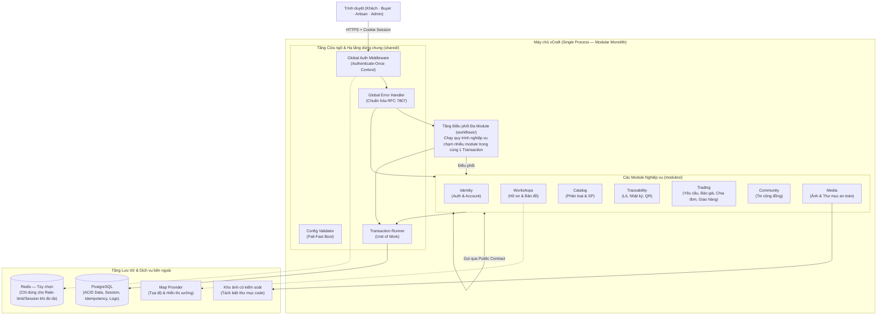
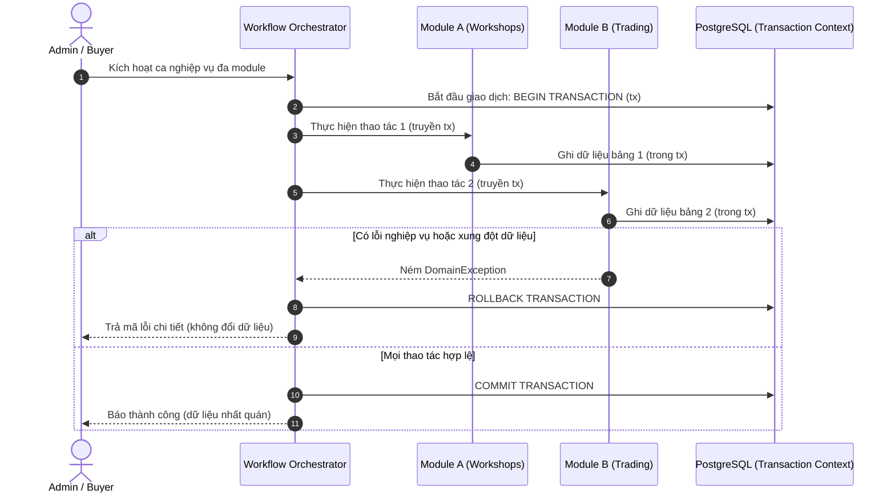
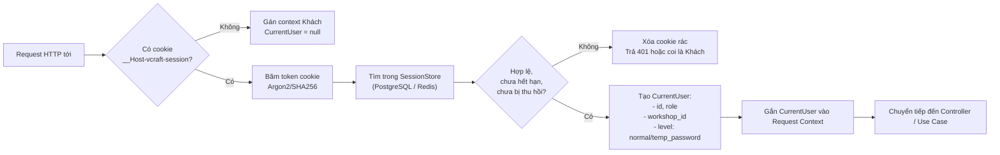
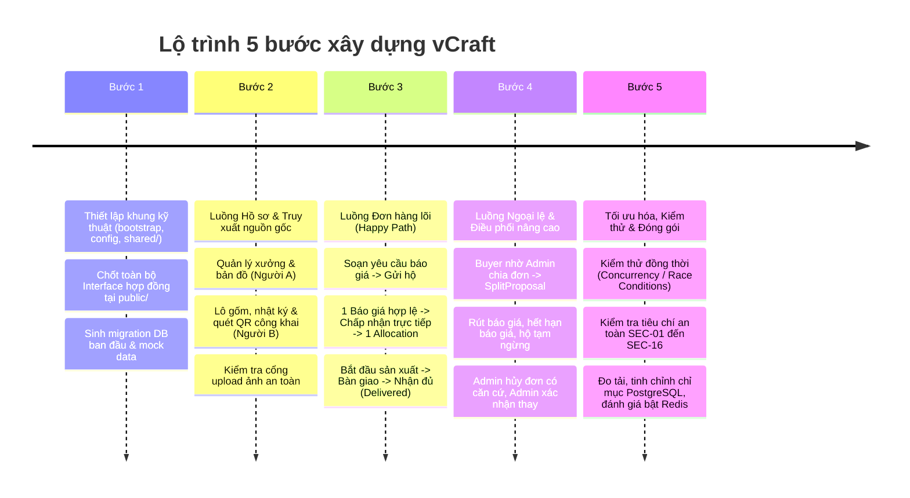

# Thiết kế kiến trúc tổng thể — vCraft

Căn cứ: [phạm vi dự án](../01-project-brief/project-scope.md), [quy tắc nghiệp vụ](../02-specifications/business-rules.md), [use cases](../02-specifications/use-cases.md), [bảo mật & phân quyền](../02-specifications/security-and-access-control.md) và [thiết kế dữ liệu](../02-specifications/data-design.md).

---

## 1. Nguyên tắc kiến trúc cốt lõi

Hệ thống vCraft được thiết kế phục vụ một làng nghề duy nhất (Bát Tràng) với nhóm phát triển gồm 3 thành viên, hướng tới mục tiêu hoạt động ổn định, bảo mật cao và sẵn sàng bảo vệ vấn đáp kỹ thuật. Kiến trúc kết hợp hài hòa 3 phong cách theo phương châm **thực dụng, tinh gọn và hướng giao dịch (transaction-first)**:

1. **Modular Monolith (Nguyên khối theo module):** Toàn bộ backend chạy trong **một tiến trình (single process)** duy nhất, sử dụng chung một cơ sở dữ liệu PostgreSQL. Các tính năng được phân chia thành các module nghiệp vụ độc lập, ranh giới rõ ràng, không phân tán thành microservices.
2. **Clean & Hexagonal Architecture "Gọn" (Ports & Adapters):** 
   - Lõi nghiệp vụ (Domain & Application) độc lập hoàn toàn với framework HTTP, thư viện ORM, kho lưu trữ file hay cache.
   - Chỉ tạo **Port** tại những ranh giới cần kiểm thử độc lập hoặc có khả năng thay thế (Repository, Storage, Hasher, Clock, Transaction Runner). Không tạo Interface dàn trải cho mọi class.
   - Thao tác truy vấn danh sách (Read Model) được phép trả DTO trực tiếp từ Adapter/SQL, không bắt buộc dựng lại toàn bộ Domain Entity phức tạp.
3. **Giao tiếp qua Hợp đồng định trước (Contract-First via Public API):**
   - Các module trong hệ thống không truy cập trực tiếp vào bảng hay domain nội bộ của nhau.
   - Mỗi module công khai một thư mục `public/` chứa **Interface Service, DTO và Enums**. Các thành viên khác chỉ phụ thuộc vào hợp đồng này, cho phép viết Mock/Stub để phát triển tính năng song song mà không bị nghẽn tiến độ.
4. **Xác thực một lần ở cửa ngõ (Authenticate-Once Context):**
   - Kiểm tra phiên đăng nhập và định danh tài khoản được xử lý tập trung một lần duy nhất tại Global Auth Middleware ở tầng ngoài cùng.
   - Middleware giải nén session cookie `__Host-vcraft-session` và gắn đối tượng chuẩn hóa `CurrentUser` vào Request Context. Các module nghiệp vụ bên trong chỉ nhận context này để kiểm tra quyền hạn (SEC-02, SEC-06), không gọi lại DB session.
5. **Nguyên tắc Thất bại sớm (Fail-Fast):**
   - **Lúc khởi động (Boot-time):** Validate toàn bộ biến môi trường `.env`, kiểm tra kết nối DB và quyền ghi thư mục ảnh trước khi mở cổng HTTP. Sai cấu hình thì dừng tiến trình ngay (`exit(1)`).
   - **Tại cửa ngõ Request:** DTO được validate chặt chẽ (schema, kiểu, giá trị âm/dương) ngay tại Controller; dữ liệu rác bị chặn với mã `400` trước khi chạm vào tầng nghiệp vụ.
   - **Trong lõi nghiệp vụ (Domain Invariants):** Mọi vi phạm quy tắc trạng thái hoặc số lượng đều ném lỗi Domain Exception lập tức để kích hoạt Rollback giao dịch.
6. **Ưu tiên Tính đúng đắn & ACID hơn Bộ nhớ đệm (Correctness over Caching):**
   - Toàn bộ thao tác chốt đơn, trừ số lượng, kiểm tra hộ hoạt động, ghi nhật ký trạng thái (StatusLog) và lưu dấu vết chống gửi lặp (IdempotencyRecord theo BR-27) đều diễn ra trong **cùng một Transaction PostgreSQL nguyên tử**.
   - Redis được thiết kế là **Adapter tùy chọn** phía sau interface `SessionStore` và `LoginAttemptStore`, không phải tầng bắt buộc phải có để hệ thống hoạt động.

---

## 2. Sơ đồ kiến trúc tổng thể



---

## 3. Tổ chức cấu trúc mã nguồn

Hệ thống được tổ chức với cấu trúc thư mục rõ ràng, phân định ranh giới giữa cấu hình, hạ tầng dùng chung, các module nghiệp vụ và quy trình điều phối đa module:

```text
backend/
├── config/                      # [Fail-Fast] Kiểm tra toàn bộ biến môi trường lúc boot
│   ├── env.schema.ts            # Schema định nghĩa các biến (DB, Port, Session Secret...)
│   └── index.ts                 # Export cấu hình đã validate; crash nếu thiếu biến
│
├── shared/                      # [Hạ tầng dùng chung] Tuyệt đối không chứa logic nghiệp vụ
│   ├── auth/                    # Middleware xác thực 1 lần, CurrentUser context, Role guard
│   ├── errors/                  # Base DomainException, HTTP error mapping, định dạng JSON lỗi
│   ├── database/                # Connection pool, Base Repository, Transaction Runner (Unit of Work)
│   ├── idempotency/             # Trình kiểm tra & lưu vết thao tác chống lặp (BR-27)
│   └── types/                   # Định dạng phân trang, chuẩn ApiResponse<T>, Date/Time helper
│
├── modules/                     # [Các module nghiệp vụ độc lập]
│   ├── identity/                # Tài khoản, băm mật khẩu Argon2id, quản lý phiên
│   ├── workshops/               # Hồ sơ xưởng, chứng nhận, tọa độ, trạng thái đón khách/vận hành
│   ├── catalog/                 # Danh mục 5 nhóm gốm, sản phẩm gốm Bát Tràng
│   ├── traceability/            # Lô sản xuất, mốc nhật ký, lịch sử sửa mốc, mã QR công khai
│   ├── trading/                 # Yêu cầu báo giá, báo giá, chia đơn, phần việc, bàn giao, hủy
│   ├── community/               # Tin tức nguyên vật liệu, lịch cúp điện, chính sách Bát Tràng
│   └── media/                   # Tải ảnh, kiểm tra MIME/kích thước, sinh ảnh 320px/1600px
│
├── workflows/                   # [Điều phối giao dịch đa module]
│   ├── register-artisan.workflow.ts  # Cấp tài khoản Artisan + Tạo Workshop ban đầu
│   ├── suspend-workshop.workflow.ts   # Tạm ngừng hộ + Hủy phương án chia đề xuất liên quan
│   └── accept-quote.workflow.ts       # Chốt báo giá + Tạo Allocation + Trừ khả năng + Đóng chào
│
├── bootstrap/                   # Điểm lắp ráp ứng dụng (Wiring Ports & Adapters)
│   └── app.ts                   # Đăng ký routes, middleware, kết nối database
│
└── main.ts                      # Entrypoint: Chạy config check -> Khởi động server
```

### Cấu trúc nội bộ của từng Module (`modules/<module_name>/`)

Mỗi module tuân thủ nguyên tắc Ports & Adapters tinh gọn:

```text
modules/trading/
├── public/                      # [HỢP ĐỒNG CÔNG KHAI - Cho các module khác gọi]
│   ├── contracts/               # Interface mà module này cung cấp cho bên ngoài
│   │   └── trading-contract.interface.ts
│   └── dtos/                    # DTO trả về cho bên ngoài, Enums trạng thái
│       └── quote-summary.dto.ts
│
├── domain/                      # [LÕI NGHIỆP VỤ - Không phụ thuộc bất kỳ thư viện ngoài nào]
│   ├── entities/                # QuoteRequest, Quote, Allocation, SplitProposal
│   ├── value-objects/           # Money (VND), Quantity, DateRange
│   ├── events/                  # Domain Events nội bộ (nếu cần)
│   └── exceptions/              # TradingDomainException (hết hạn, sai trạng thái...)
│
├── application/                 # [USE CASES & PORTS NỘI BỘ]
│   ├── use-cases/               # CreateQuoteRequest, SubmitQuote, AcceptQuoteDirectly...
│   └── ports/                   # Repository Interfaces (IQuoteRequestRepository, IQuoteRepository)
│
└── adapters/                    # [TRIỂN KHAI KỸ THUẬT CỤ THỂ]
    ├── http/                    # Controllers, Express/Nest/Fastify routes, Request validation
    └── persistence/             # TypeORM/Prisma/Kysely/SQL queries, Repository implementations
```

> **Quy tắc phụ thuộc bất biến (Architectural Boundary Rules):**
> 1. Module X **CHỈ ĐƯỢC PHÉP import** từ `modules/Y/public`. Tuyệt đối không import từ `domain`, `application` hay `adapters` của module khác.
> 2. `domain` không import bất kỳ thứ gì từ `adapters` hay thư viện framework ngoài.
> 3. `shared/` không phụ thuộc ngược lại bất kỳ module nào trong `modules/`.

---

## 4. Giao tiếp liên module và Quản trị Giao dịch (Workflows)

### 4.1. Giao tiếp qua Hợp đồng (Contract-First)

Khi Module A cần dữ liệu hoặc xác thực từ Module B:
1. Module B công khai Interface trong `modules/B/public/contracts/`.
2. Module B triển khai interface đó trong chính module của mình.
3. Module A chỉ tiêm (*inject*) Interface đó để gọi.
4. **Hỗ trợ phát triển song song:** Người phụ trách Module A có thể tạo một `MockModuleBContract` trong thư mục test để code hoàn chỉnh use case của mình ngay cả khi người phụ trách Module B chưa viết xong cơ sở dữ liệu.

*Ví dụ về Hợp đồng liên module:*
```typescript
// modules/workshops/public/contracts/workshop-contract.interface.ts
export interface IWorkshopContract {
  isWorkshopActive(workshopId: bigint): Promise<boolean>;
  getWorkshopSummary(workshopId: bigint): Promise<WorkshopSummaryDto | null>;
  findEligibleWorkshopsForCategory(categoryId: bigint): Promise<bigint[]>;
}
```

### 4.2. Điều phối giao dịch đa module (`workflows/`)

Có những ca nghiệp vụ thay đổi dữ liệu trên nhiều module và bắt buộc phải **thành công toàn bộ hoặc thất bại toàn bộ (ACID)**. Các use case này không thuộc riêng về một module nào mà được đặt tại tầng `workflows/`.

*Chiến lược thực thi:*
- Dùng mẫu `Transaction Runner` / `Unit of Work` từ `shared/database`.
- Tầng workflow mở một Transaction Context `tx`.
- Gọi lần lượt các hàm nghiệp vụ của các module liên quan, truyền `tx` vào dưới dạng tham số tùy chọn.
- Nếu xảy ra bất kỳ lỗi nghiệp vụ nào, toàn bộ transaction được rollback tự động.



### 4.3. Tách biệt Đọc (Query) và Ghi (Command) — Lightweight CQRS

Để tránh bẫy hiệu năng **N+1 Query** khi hiển thị các bảng danh sách phức tạp (ví dụ: màn hình danh sách đơn hàng của Admin cần hiển thị: Mã đơn, Tên người mua, Tên các xưởng báo giá, Trạng thái, Tổng tiền):
* **Đối với luồng Ghi (State Mutation):** Bắt buộc đi qua Domain Entity, nạp đầy đủ Aggregate Root để kiểm tra quy tắc trạng thái và versioning.
* **Đối với luồng Đọc (Read / Query DTO):** Controller/Query Service trong `adapters/persistence` được phép viết các câu truy vấn SQL JOIN trực tiếp các bảng giữa các module để lấy thẳng DTO mong muốn đưa ra API. Điều này giúp tận dụng triệt để sức mạnh chỉ mục (Index) của PostgreSQL mà không làm bẩn mô hình Domain.

---

## 5. Tầng dùng chung (`shared/`) và Cửa ngõ bảo mật

### 5.1. Cơ chế "Xác thực một lần" (Authenticate-Once Pipeline)

Tuân thủ nghiêm ngặt **SEC-02, SEC-05 và SEC-06**, luồng xác thực diễn ra tại Global Middleware:



*Lợi ích:* Use case nghiệp vụ bên trong chỉ cần đọc thông tin đã tin cậy từ `context.currentUser`, không cần kết nối tới bảng phiên hay kiểm tra token phức tạp.

### 5.2. Chuẩn hóa mã lỗi toàn hệ thống (Global Error Handling)

Mọi ngoại lệ trong hệ thống đều được bắt tại `GlobalErrorHandler` ở `shared/errors` và chuyển đổi sang chuẩn **RFC 7807 (Problem Details)**:

| Tầng ném lỗi | Lớp Exception | HTTP Status | Cấu trúc phản hồi JSON |
| :--- | :--- | :---: | :--- |
| **Cửa ngõ** | `RequestValidationException` | `400 Bad Request` | `{"code": "INVALID_INPUT", "details": [...]}` |
| **Xác thực** | `UnauthorizedException` | `401 Unauthorized` | `{"code": "AUTHENTICATION_REQUIRED", "message": "..."}` |
| **Phân quyền** | `ForbiddenException` | `403 Forbidden` | `{"code": "PERMISSION_DENIED", "message": "..."}` |
| **Không tìm thấy** | `EntityNotFoundException` | `404 Not Found` | `{"code": "NOT_FOUND", "message": "..."}` |
| **Tranh chấp** | `ConcurrencyConflictException` | `409 Conflict` | `{"code": "CONCURRENCY_CONFLICT", "message": "Dữ liệu đã thay đổi, vui lòng tải lại"}` |
| **Nghiệp vụ** | `DomainRuleViolationException` | `422 Unprocessable` | `{"code": "QUOTE_ACCEPTANCE_EXPIRED", "message": "Báo giá đã quá hạn"}` |
| **Tần suất** | `RateLimitExceededException` | `429 Too Many Requests` | `{"code": "RATE_LIMIT_EXCEEDED", "retry_after": 900}` |
| **Hệ thống** | Lỗi không mong muốn / DB sập | `500 Internal Error` | `{"code": "INTERNAL_SERVER_ERROR", "tracking_id": "uuid"}` *(giấu stacktrace)* |

---

## 6. Chiến lược thực thi nguyên tắc Fail-Fast

Hệ thống thiết lập 3 phòng tuyến Fail-Fast nhằm ngăn ngừa triệt để lỗi âm thầm (*silent failure*):


---

## 7. Phân chia công việc và Kế hoạch thực hiện (Nhóm 3 người)

Phân chia theo lát cắt dọc (**Vertical Slice** — mỗi người chịu trách nhiệm cả Frontend UI, Backend Logic và Database Migration của phần mình) để tránh tình trạng chờ đợi chéo giữa Frontend và Backend.

### 7.1. Bảng phân công trách nhiệm

| Thành viên | Module phụ trách chính | Phạm vi cụ thể | Giao diện liên module cần cung cấp |
| :---: | :--- | :--- | :--- |
| **Người A** | `identity`<br>`workshops`<br>`community` | - Đăng ký, đăng nhập, đổi/đặt lại mật khẩu, quản lý phiên.<br>- Tạo hồ sơ xưởng ban đầu, duyệt hộ, bật/tắt đón khách.<br>- Bản đồ xưởng Bát Tràng (Map API).<br>- Tin tức nguyên vật liệu, chính sách, lịch cúp điện. | `IIdentityContract`<br>`IWorkshopContract` (kiểm tra hộ active, tọa độ xưởng) |
| **Người B** | `catalog`<br>`traceability`<br>`media` | - Quản lý 5 phân loại gốm, sản phẩm gốm theo hộ.<br>- Tạo lô, ghi nhật ký sản xuất, lịch sử sửa mốc.<br>- Công bố lô và sinh/hiển thị mã QR công khai.<br>- Cổng tải ảnh, xác thực chữ ký ảnh, sinh ảnh 320px/1600px. | `ICatalogContract`<br>`ITraceabilityContract` (kiểm tra lô thuộc hộ, trạng thái công bố)<br>`IMediaContract` (gắn ảnh đã xử lý) |
| **Người C** | `trading`<br>*(Workflow cốt lõi)* | - Vòng đời QuoteRequest (6 trạng thái + Hủy).<br>- Phản hồi mời, gửi/sửa/rút báo giá.<br>- Điều phối chia đơn (Admin SplitProposal).<br>- Phân việc (Allocation), ghi nhận bàn giao, Buyer xác nhận nhận đủ.<br>- Kiểm tra IdempotencyRecord và concurrency version. | Phụ thuộc vào `IWorkshopContract`, `ITraceabilityContract`, `IMediaContract` |

> **Quy tắc phối hợp:** `trading` là module có độ phức tạp cao nhất. Người A và B sau khi hoàn thành khung nền tảng của mình ở Tuần 1-2 sẽ chuyển sang hỗ trợ Người C: Người A hỗ trợ cắt giao diện biểu mẫu/danh sách phía Frontend; Người B hỗ trợ viết các bộ kiểm thử tích hợp (Integration Test) cho luồng chốt đơn và hủy đơn.

### 7.2. Lộ trình triển khai 5 bước (Implementation Roadmap)



---

*Tài liệu này là căn cứ kiến trúc thống nhất cho đội ngũ phát triển. Mọi thay đổi về ranh giới module, hợp đồng public hoặc chiến lược transaction phải được toàn nhóm thảo luận và cập nhật trực tiếp tại đây.*

