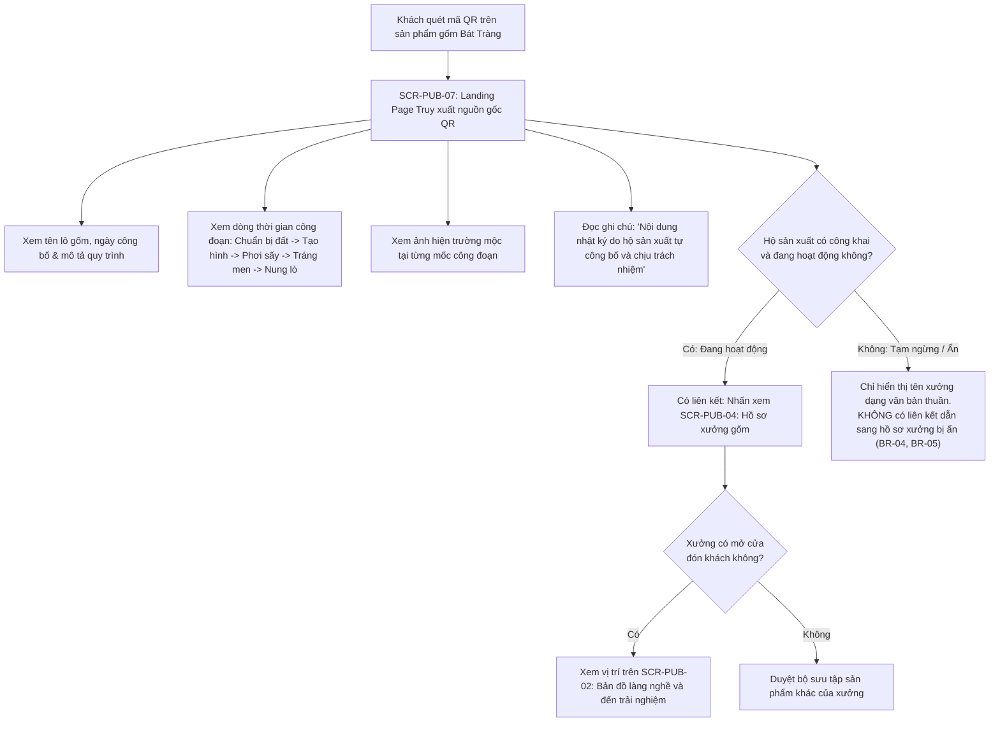
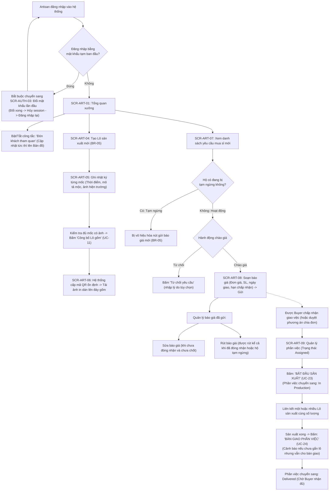
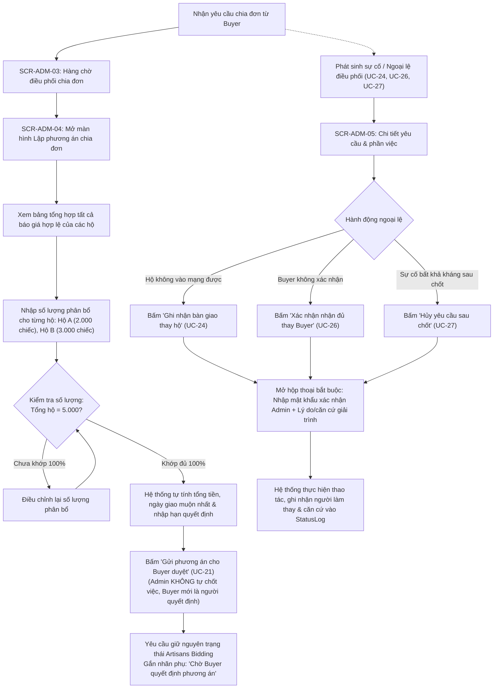

# Sơ đồ điều hướng & Luồng người dùng — vCraft

Căn cứ: [danh mục màn hình](screen-inventory.md), [đặc tả use case](../02-specifications/use-cases.md), [quy tắc nghiệp vụ](../02-specifications/business-rules.md) và [bảo mật & phân quyền](../02-specifications/security-and-access-control.md).

Tài liệu này trực quan hóa cấu trúc điều hướng giữa các màn hình, các luồng hành trình người dùng (User Journeys) chính xác theo quy chuẩn nghiệp vụ của vCraft (Làng gốm Bát Tràng) bằng các biểu đồ Mermaid tiêu chuẩn.

---

## 1. Sơ đồ cấu trúc điều hướng tổng thể (Site Map)

```mermaid
graph TD
    classDef public fill:#f5f0eb,stroke:#8c6239,stroke-width:1.5px,color:#2c1810;
    classDef buyer fill:#e6f0fa,stroke:#2b5c8f,stroke-width:1.5px,color:#102a45;
    classDef artisan fill:#eaf5ea,stroke:#3b7a3b,stroke-width:1.5px,color:#133813;
    classDef admin fill:#fbeee6,stroke:#a04000,stroke-width:1.5px,color:#4a1e00;

    %% Public Portal
    Home["SCR-PUB-01: Trang chủ vCraft"]:::public
    Map["SCR-PUB-02: Bản đồ số Làng gốm"]:::public
    Catalog["SCR-PUB-05: Danh mục sản phẩm"]:::public
    ProdDetail["SCR-PUB-06: Chi tiết sản phẩm"]:::public
    Workshops["SCR-PUB-03: Khám phá xưởng"]:::public
    WorkshopDetail["SCR-PUB-04: Hồ sơ xưởng gốm"]:::public
    TraceQR["SCR-PUB-07: Truy xuất nguồn gốc QR"]:::public
    News["SCR-PUB-08: Tin tức cộng đồng"]:::public
    NewsDetail["SCR-PUB-09: Chi tiết bài viết"]:::public
    Login["SCR-AUTH-01: Đăng nhập (Username)"]:::public
    Register["SCR-AUTH-02: Đăng ký Buyer"]:::public
    ChangePass["SCR-AUTH-03: Đổi mật khẩu"]:::public

    Home --> Map
    Home --> Catalog
    Home --> Workshops
    Home --> News
    Home --> Login
    Home --> Register
    Catalog --> ProdDetail
    ProdDetail -.-> TraceQR
    Workshops --> WorkshopDetail
    WorkshopDetail -.-> Map
    News --> NewsDetail

    Login -->|Mật khẩu tạm / Lần đầu| ChangePass
    ChangePass -->|Đổi thành công: Hủy session| Login

    %% Buyer Portal
    BuyerReqs["SCR-BUY-01: Danh sách yêu cầu sỉ"]:::buyer
    NewReq["SCR-BUY-02: Soạn/Sửa yêu cầu báo giá"]:::buyer
    BiddingRoom["SCR-BUY-03: Chi tiết & Phòng Bidding"]:::buyer
    ProposalReview["SCR-BUY-04: Duyệt chia đơn BQL"]:::buyer
    Tracking["SCR-BUY-05: Tiến độ & Nhận hàng"]:::buyer

    Login -->|Vai trò: Buyer| BuyerReqs
    BuyerReqs --> NewReq
    BuyerReqs --> BiddingRoom
    BiddingRoom --> ProposalReview
    BiddingRoom --> Tracking
    Tracking -.-> TraceQR

    %% Artisan Portal
    ArtDashboard["SCR-ART-01: Tổng quan xưởng"]:::artisan
    ArtProfile["SCR-ART-02: Quản lý hồ sơ xưởng"]:::artisan
    ArtProducts["SCR-ART-03: Quản lý sản phẩm"]:::artisan
    ArtBatches["SCR-ART-04: Quản lý lô gốm"]:::artisan
    ArtStages["SCR-ART-05: Nhật ký công đoạn"]:::artisan
    ArtQR["SCR-ART-06: Thẻ QR Code lô"]:::artisan
    ArtInbox["SCR-ART-07: Yêu cầu chào giá đến"]:::artisan
    ArtQuote["SCR-ART-08: Soạn/Sửa/Rút báo giá"]:::artisan
    ArtAllocations["SCR-ART-09: Quản lý phần việc"]:::artisan

    Login -->|Vai trò: Artisan| ArtDashboard
    ArtDashboard --> ArtProfile
    ArtDashboard --> ArtProducts
    ArtDashboard --> ArtBatches
    ArtBatches --> ArtStages
    ArtStages --> ArtQR
    ArtDashboard --> ArtInbox
    ArtInbox --> ArtQuote
    ArtDashboard --> ArtAllocations
    ArtAllocations -.-> ArtBatches

    %% Admin Portal
    AdminDash["SCR-ADM-01: Bảng điều hành BQL"]:::admin
    AdminArtisans["SCR-ADM-02: Quản lý hộ gốm"]:::admin
    AdminCoord["SCR-ADM-03: Hàng chờ chia đơn"]:::admin
    AdminPlan["SCR-ADM-04: Lập phương án chia"]:::admin
    AdminDetail["SCR-ADM-05: Chi tiết & Xử lý ngoại lệ"]:::admin
    AdminCats["SCR-ADM-06: Quản lý phân loại"]:::admin
    AdminNews["SCR-ADM-07: Quản lý tin tức"]:::admin
    AdminAudit["SCR-ADM-08: Nhật ký kiểm toán"]:::admin

    Login -->|Vai trò: Admin| AdminDash
    AdminDash --> AdminArtisans
    AdminDash --> AdminCoord
    AdminCoord --> AdminPlan
    AdminCoord --> AdminDetail
    AdminDash --> AdminCats
    AdminDash --> AdminNews
    AdminDash --> AdminAudit
```

---

## 2. Các luồng hành trình người dùng cốt lõi (User Journey Flows)

### 2.1. Luồng 1: Khách tham quan & Truy xuất nguồn gốc QR (Tourist Flow)

---

### 2.2. Luồng 2: Quy trình mua sỉ B2B & Chấp nhận đơn (Buyer Procurement Flow)

Tuân thủ chính xác 6 trạng thái bắt buộc: `Draft Request` $\rightarrow$ `Sent to Artisans` $\rightarrow$ `Artisans Bidding` $\rightarrow$ `Buyer Accepted` $\rightarrow$ `In Production` $\rightarrow$ `Delivered`.

```mermaid
flowchart TD
    CreateReq["SCR-BUY-02: Soạn yêu cầu báo giá sỉ<br>(5.000 chiếc cốc, men trắng, in logo)"] --> SubmitReq["Bấm 'Gửi yêu cầu đến các hộ' (UC-15)"]
    SubmitReq --> BiddingRoom["SCR-BUY-03: Phòng Bidding & So sánh báo giá<br>(Trạng thái: Artisans Bidding)"]
    
    BiddingRoom --> WaitQuotes["Các hộ gửi báo giá<br>(Hiển thị: Đơn giá, SL, Ngày giao, Hạn chấp nhận)"]
    
    WaitQuotes --> Decision{"Lựa chọn của Buyer"}
    
    %% Nhánh 1: Chấp nhận trực tiếp
    Decision -- "1 hộ đáp ứng đủ 100% SL" --> DirectAccept["Buyer bấm 'Chấp nhận trực tiếp' hộ này (UC-19)"]
    DirectAccept --> SetAccepted1["Hệ thống chuyển trạng thái yêu cầu sang: Buyer Accepted<br>Tạo 01 phần việc ở trạng thái: Assigned"]
    
    %% Nhánh 2: Nhờ Ban quản lý chia đơn
    Decision -- "Muốn chia đơn cho nhiều hộ" --> CloseAndAsk["Buyer bấm: 'Đóng nhận sớm và nhờ BQL chia đơn' (UC-20)<br>(Gọi API Đóng nhận -> Gọi API Nhờ BQL chia đơn)"]
    CloseAndAsk --> BiddingClosed["Yêu cầu chuyển sang nhãn phụ: 'Bidding Closed'<br>Trạng thái chính vẫn là: Artisans Bidding"]
    BiddingClosed --> WaitForPlan["Chờ Ban quản lý Bát Tràng lập phương án chia đơn..."]
    WaitForPlan --> ReviewPlan["SCR-BUY-04: Màn hình Phê duyệt phương án BQL<br>(Nhãn phụ: 'Chờ Buyer quyết định phương án')"]
    ReviewPlan --> PlanDecision{"Buyer phê duyệt?"}
    
    PlanDecision -- "Từ chối (nhập lý do)" --> RejectPlan["Bấm 'Từ chối phương án' (UC-22)<br>Yêu cầu quay lại Bidding chờ giải pháp khác"]
    PlanDecision -- "Đồng ý" --> AcceptPlan["Bấm 'Chấp nhận phương án' (UC-22)"]
    AcceptPlan --> SetAccepted2["Hệ thống chuyển trạng thái yêu cầu sang: Buyer Accepted<br>Tạo các phần việc tương ứng ở trạng thái: Assigned"]
    
    %% Chuyển từ Buyer Accepted sang In Production
    SetAccepted1 --> WaitArtisanStart["Yêu cầu ở trạng thái: Buyer Accepted<br>(Chờ các hộ vào nhận việc và bắt đầu sản xuất)"]
    SetAccepted2 --> WaitArtisanStart
    
    WaitArtisanStart --> ArtisanStarts["Hộ đầu tiên bấm: 'Bắt đầu sản xuất' (UC-23)<br>(Phần việc của hộ chuyển sang In Production)"]
    ArtisanStarts --> SetInProd["Hệ thống chuyển trạng thái yêu cầu sang: In Production"]
    
    %% Giai đoạn hoàn tất
    SetInProd --> TrackFlow["SCR-BUY-05: Theo dõi tiến độ từng phần việc"]
    TrackFlow --> ArtisansDelivering["Từng hộ hoàn thành và bấm: 'Bàn giao phần việc' (UC-24)<br>(Từng phần việc chuyển sang Delivered)"]
    ArtisansDelivering --> AllDelivered{"Tất cả phần việc<br>đã bàn giao đủ?"}
    AllDelivered -- Chưa đủ --> TrackFlow
    AllDelivered -- Đã đủ 100% --> ConfirmReceipt["Buyer kiểm tra thực tế và bấm:<br>'Xác nhận nhận đủ hàng' (UC-25)"]
    ConfirmReceipt --> Completed["Yêu cầu chuyển sang: Delivered (Hoàn tất toàn bộ đơn hàng)"]
```

---

### 2.3. Luồng 3: Nghệ nhân tác nghiệp xưởng & Chào giá (Artisan Production & Bidding Flow)

---

### 2.4. Luồng 4: Ban quản lý điều phối chia đơn & Xử lý ngoại lệ (Admin Governance Flow)

---

## 3. Cơ chế bảo vệ điều hướng (Navigation Guards & Action-level Permissions)

Hệ thống triển khai kiểm soát quyền truy cập chi tiết theo từng hành động (*Action-level Authorization*) thay vì chặn cứng toàn bộ màn hình:

| Ngữ cảnh hệ thống | Thao tác được phép thực hiện | Thao tác bị chặn / Vô hiệu hóa | Chuyển hướng & Phản hồi giao diện |
|---|---|---|---|
| **Chưa đăng nhập** | Xem trang công khai (Bản đồ, Sản phẩm, Xưởng, QR, Tin tức), Đăng ký Buyer, Đăng nhập. | Truy cập `/buyer/*`, `/artisan/*`, `/admin/*`. | Chuyển hướng về `/login?redirect={current_url}`. |
| **Đăng nhập mật khẩu tạm** | Đổi mật khẩu lần đầu tại `SCR-AUTH-03`. | Truy cập bất kỳ màn hình nghiệp vụ nào khác trong Portal. | Bắt buộc chuyển hướng về `SCR-AUTH-03` kèm thông báo: *"Bạn cần đổi mật khẩu trước khi tiếp tục"*. |
| **Hộ tạm ngừng (`Suspended` - BR-05)** | • Quản lý hồ sơ xưởng hiện tại. • **Tạo Lô gốm mới và ghi nhật ký mộc**. • Tiếp tục sản xuất và bàn giao các phần việc đã chốt trước đó. • **Rút báo giá đã gửi** (chưa chốt). | • **Gửi báo giá mới** cho bất kỳ yêu cầu nào. • Nhận thêm phần việc mới. | Hiển thị Banner vàng cố định trên đầu trang: *"Xưởng đang tạm ngừng nhận việc mới. Bạn vẫn có thể tạo lô, ghi nhật ký và hoàn thành các đơn hàng đã chốt trước đó"*. Nút "Gửi báo giá" bị mờ (Disabled). |
| **Yêu cầu đã Đóng nhận báo giá (`Bidding Closed`)** | • Buyer xem so sánh các báo giá đã nhận, nhờ BQL chia đơn, hủy yêu cầu. • Artisan **được phép Rút báo giá** đã gửi (BR-14, BR-15). | • Artisan gửi thêm báo giá mới hoặc sửa tăng/giảm giá. | Trạng thái hiển thị nhãn phụ *"Đã đóng nhận báo giá"*. Form gửi báo giá bị khóa; nút **"Rút báo giá"** vẫn hoạt động bình thường. |
| **Yêu cầu đã Chốt (`Buyer Accepted` / `In Production`)** | • Buyer theo dõi tiến độ, sửa thông tin liên hệ nhận hàng. • Artisan bắt đầu sản xuất, gắn lô gốm, bàn giao phần việc. | • Buyer tự ý hủy yêu cầu (sau chốt chỉ Admin mới có quyền hủy có căn cứ - BR-22). • Artisan rút báo giá (báo giá đã trở thành phần việc trúng thầu). | Nút Hủy của Buyer chuyển thành: *"Yêu cầu đã chốt. Nếu có sự cố bất khả kháng, vui lòng liên hệ Ban quản lý"*. |
| **Yêu cầu đã Hủy (`Cancelled`)** | Xem lại dữ liệu lịch sử dạng chỉ đọc (Read-only). | Toàn bộ thao tác chào giá, chấp nhận, bắt đầu làm, bàn giao. | Hiển thị Banner đỏ: *"Yêu cầu này đã bị hủy vào lúc {thời_gian}. Lý do: {ly_do}"*. Toàn bộ form và nút hành động bị ẩn. |
